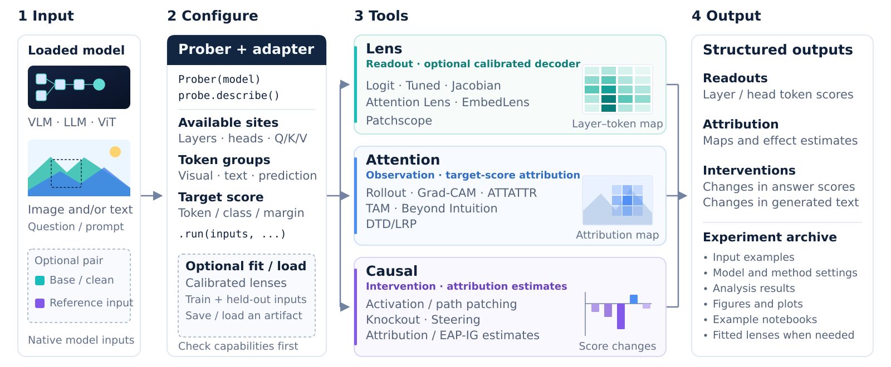
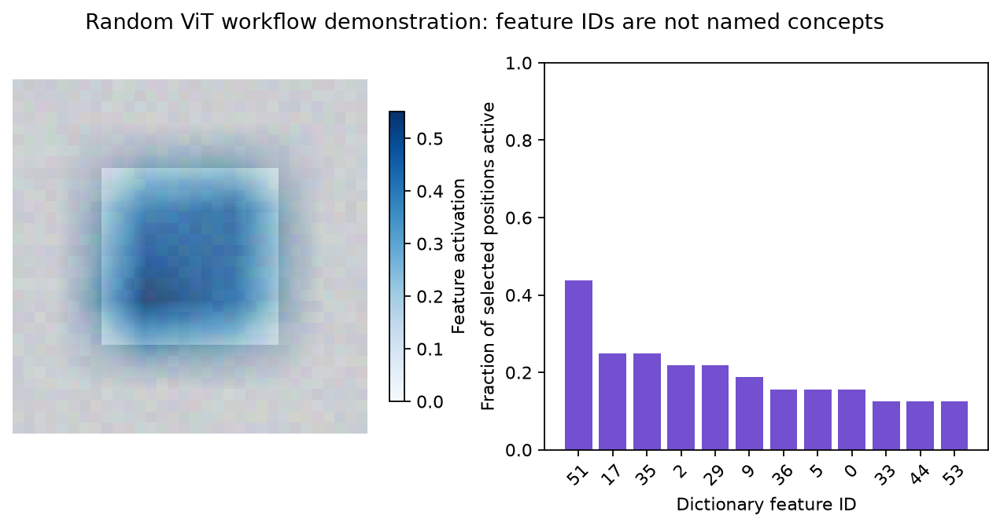

<p align="center">
  
</p>

<h1 align="center">vlmprobe</h1>

<p align="center"><strong>Exploring Model Internals Beyond the Answer</strong></p>

<p align="center">
  <a href="https://gexinh.github.io/vlm-probing/"></a>
</p>

vlmprobe brings lens readouts, attention explanations, causal interventions,
and trained sparse feature dictionaries into one model-bound interface. It supports vision-language
models, language models, native vision encoders, and a ViT image-classification control. Bind a loaded
model once, select layers and token groups, and inspect how its internal
computation relates to a chosen answer.

- **Lens:** read vocabulary predictions from residual states, attention heads,
  or projected visual embeddings.
- **Attention:** compare attention patterns and target-conditioned spatial
  attributions on the same input.
- **Causal:** replace activations, isolate paths, block attention routes, or steer
  residual states and measure the resulting change.
- **SAE:** train and load sparse dictionaries, inspect visual or text features,
  and intervene on feature activations. Ten SAE families/training variants are
  available through native and bundled research implementations.

Explicit adapters handle hook locations, expanded visual-token coordinates,
and model readouts. Results retain tensors and experiment metadata; shared
visualization functions turn them into heatmaps, image overlays, curves, and
connection graphs. Capability checks distinguish an unsupported operation from
a measured zero effect.

<p align="center">
  
</p>

[Documentation](docs/README.md) · [Demos](demos/README.md) ·
[Visualization](docs/VISUALIZATION.md) ·
[Technical report](docs/assets/vlmprobe-technical-report.pdf) ·
[Papers and datasets](docs/REFERENCES.md)

[SAE methods](#sae-methods) · [SAE quick start](#sae-quick-start) ·
[Train on your data](#train-on-your-own-data) · [Pretrained SAE resources](#pretrained-sae-resources)

## SAE Methods

The following **10 SAE families/training variants** are implemented. The
selected SAELens, ViT-Prisma and Overcomplete cores are bundled at fixed source
revisions; no official toolkit package is installed or selected at runtime.

| Method | What it does | Available implementations |
| --- | --- | --- |
| ReLU + L1 | Learns nonnegative features using reconstruction and sparsity losses. | Native · SAELens (`standard`) · Prisma · Overcomplete |
| Gated SAE | Separates feature selection from feature magnitude. | Native · SAELens · Prisma |
| TopK SAE | Retains the largest `k` nonnegative features per activation vector. | Native · SAELens · Prisma · Overcomplete |
| JumpReLU SAE | Learns feature thresholds and retains above-threshold activations. | SAELens · Overcomplete |
| AbsTopK SAE | Selects by absolute magnitude and retains signed feature values. | SAELens |
| Matching Pursuit SAE | Iteratively selects dictionary atoms to explain the remaining residual. | SAELens |
| BatchTopK SAE | Shares the sparse activation budget across a training batch. | SAELens · Overcomplete |
| Matryoshka BatchTopK SAE | Trains nested dictionary widths with reconstruction objectives. | SAELens training; JumpReLU inference export |
| Relaxed Archetypal TopK SAE | Uses training-data archetypes plus bounded dictionary relaxation. | Overcomplete |
| Relaxed Archetypal JumpReLU SAE | Combines the archetypal dictionary with learned feature thresholds. | Overcomplete |

Choose the implementation with its own constructor/training options, then use
one shared `probe.sae` interface for analysis:

| Implementation | Construction and training | Full parameter and usage guide |
| --- | --- | --- |
| Native | `SparseAutoencoder(SAEConfig(...))` → `train_sae(...)` | [ReLU / TopK / Gated](docs/sae.md) |
| SAELens | `saelens.train(config=..., activation_source=..., ...)` | [Eight training architectures, sample budgets and checkpoints](docs/sae/saelens.md) |
| ViT-Prisma | `prisma.train(config=..., dataset=..., eval_dataset=..., ...)` | [ReLU / TopK / Gated, image inputs and native hooks](docs/sae/prisma.md) |
| Overcomplete | `overcomplete.create(...)` → `overcomplete.train(...)` | [Six architectures, losses and validation](docs/sae/overcomplete.md) |

Architecture names do not imply identical training recipes. In BatchTopK,
SAELens `k` is an average count per vector; Overcomplete `top_k` is a total count
across the training batch. Native TopK omits AuxK, and Overcomplete's default
JumpReLU objective is MSE + L1. Exact options and objectives are documented in
the implementation guides above.

## Installation

Python 3.10+ is required. **The SAE preview is on `dev/sae-v3` and has not been
released on PyPI.** Install this branch to use the SAE methods above:

```bash
python -m pip install "vlmprobe[sae,transformers,visualization] @ git+https://github.com/gexinh/vlm-prob.git@dev/sae-v3"
```

To run the repository examples or develop locally:

```bash
git clone --branch dev/sae-v3 --single-branch https://github.com/gexinh/vlm-prob.git
cd vlm-prob
python -m pip install -e ".[sae,transformers,visualization]"
```

The `sae` extra installs generic numerical/download dependencies, including
Einops, NumPy, Safetensors and Hugging Face Hub. The SAE implementation source
is included in VLMProbe; it does not depend on installed `sae-lens`, `vit-prisma`,
`overcomplete` or TransformerLens packages.

For the released Lens / Attention / Causal package, install from
[PyPI](https://pypi.org/project/vlmprobe/):

```bash
python -m pip install "vlmprobe[transformers,visualization]"
```

The base package (`pip install vlmprobe`) requires only PyTorch. Add
`visualization` for plots, `transformers` for Hugging Face model support, and
`notebooks` for Jupyter. Model and SAE weights are downloaded separately.
The import name is **`vlmprobe`**; existing `vlm_probing` imports remain compatible.
See the [package guide](docs/PACKAGING.md) for wheels and release publication.

## Quick Start

This example loads **Qwen3-VL-2B-Instruct** on one CUDA GPU. Replace
`example.jpg` with your image, or use an image from [the bundled demos](demos/README.md).

```python
import torch
from PIL import Image
from transformers import AutoModelForImageTextToText, AutoProcessor
from vlmprobe import Prober

model_id = "Qwen/Qwen3-VL-2B-Instruct"
model = AutoModelForImageTextToText.from_pretrained(
    model_id, dtype=torch.bfloat16, device_map={"": "cuda:0"},
    attn_implementation="eager",
)
processor = AutoProcessor.from_pretrained(model_id)
probe = Prober(model, processor)

messages = [{"role": "user", "content": [
    {"type": "image"},
    {"type": "text", "text": "What is in this image?"},
]}]
prompt = processor.apply_chat_template(
    messages, tokenize=False, add_generation_prompt=True,
)
inputs = probe.prepare(
    prompt=prompt, image=Image.open("example.jpg").convert("RGB"), device="cuda:0",
)

print(probe.describe()["methods"]["lens.logit"])
result = probe.lens.logit(layers=[0, 13, 27], tokens="last_prompt").run(inputs)
token_id = result.tensors["logits"][-1, 0].argmax().item()
print(processor.tokenizer.decode([token_id]))
result.save("outputs/logit_lens")

# Read projected image tokens in the input embedding space.
visual = probe.lens.embed(tokens="visual").run(inputs, top_k=5)

# Observe the attention actually used by the language decoder.
attention = probe.attention.profile(
    layers=[27], queries="last_prompt", include_attention=True,
).run(inputs)
```

Use a model you have already loaded, and pass its native processor dictionary
directly to `.run(...)` when convenient. Layer indices are zero-based; tokens
refer to the expanded sequence, including image positions. The
[model guides](docs/models/README.md) explain each architecture's input contract.

```python
from vlmprobe import visualization as viz

answer_id = processor.tokenizer.encode(" yellow", add_special_tokens=False)[0]
ax = viz.plot_lens_heatmap(result, target_token_id=answer_id)
ax.figure.savefig("outputs/lens.png", bbox_inches="tight")
```

This plots one vocabulary token's rank across selected layers and positions.
A complete answer can contain several tokens; choose the intended subword
explicitly, or use complete-answer metrics for interventions.

| Common operation | Purpose |
| --- | --- |
| `Prober(model, processor=None)` | Bind a caller-owned model and resolve its adapter. |
| `probe.describe()` | Inspect available methods, sites, and missing capabilities. |
| `probe.prepare(prompt=..., image=..., device=...)` | Convert formatted text and images into native inputs. |
| `probe.lens / probe.attention / probe.causal / probe.sae` | Configure a method in one of four families. |
| `method.run(inputs, ...)` | Execute a probe and return `ProbeResult`. |
| `method.fit_batches(...)` / `method.load(...)` | Calibrate or restore Tuned/Attention Lens; Jacobian Lens has a separate estimator. |
| `probe.sae.features / profile / reconstruct / edit` | Inspect a trained SAE and measure feature interventions. |
| `result.save(directory)` | Save CPU tensors and JSON metadata. |

[The API guide](docs/API.md) covers selectors, complete-answer metrics,
paired-input alignment, and result shapes. [Visualization](docs/VISUALIZATION.md)
describes reusable plotting functions. The [demos](demos/README.md) walk through
input preparation, live model calls, calibration when needed, and plotting.
Every [method guide](docs/methods/README.md) includes parameter defaults and a complete input-to-output example.
A [small CPU example](examples/prober_quickstart.py)
exercises the API without downloading pretrained weights.

## SAE Quick Start

This complete CPU example uses the bundled Prisma vision core and the native
TopK SAE trainer. It creates independent synthetic image splits, runs a frozen
random ViT to collect activations, trains and reloads an SAE, and visualizes
held-out features. It needs no model download or prepared result cache.
Random-backbone feature IDs are not named semantic concepts.

From a repository checkout, run the [same workflow](examples/sae_quickstart.py):

```bash
python examples/sae_quickstart.py --output-dir outputs/sae_quickstart
```

Or run the full code below after installing this branch:

```python
"""CPU image-to-SAE workflow; random ViT features are not named concepts."""
import hashlib
import json
from pathlib import Path
import tempfile

import matplotlib
matplotlib.use("Agg")
import matplotlib.pyplot as plt
from PIL import Image
import torch
from vlmprobe import Prober, visualization as viz
from vlmprobe.sae import SAEConfig, SparseAutoencoder, build_sae_binding
from vlmprobe.sae.training import train_sae
from vlmprobe.sae.backends import prisma
from vlmprobe.sae.backends.prisma import HookedViT, HookedViTConfig

base = Path("outputs/sae_quickstart")
base.mkdir(parents=True, exist_ok=True)
output = Path(tempfile.mkdtemp(prefix="run-", dir=base))  # Every run is fresh.
torch.manual_seed(42)
torch.set_num_threads(1)
model = HookedViT(HookedViTConfig(
    n_layers=2, d_model=16, d_head=4, d_mlp=32, n_heads=4, n_channels=3,
    patch_size=8, image_size=32, device="cpu", model_name="tiny-image-demo",
    return_type="pre_logits",
)).eval().requires_grad_(False)
# Independent image splits; these exact RGB tensors are the model inputs.
def images(seed, count):
    generator = torch.Generator().manual_seed(seed)
    pixels = torch.randint(0, 64, (count, 3, 32, 32), generator=generator)
    pixels[:, :, 8:24, 8:24] += torch.randint(64, 192, (count, 3, 1, 1), generator=generator)
    return pixels.float() / 255
train_images, validation_images, test_images = images(11, 32), images(22, 8), images(33, 2)
digest = hashlib.sha256()
for name, value in sorted(model.state_dict().items()):
    digest.update(name.encode() + value.detach().numpy().tobytes())
model_id = "tiny-image-demo@" + digest.hexdigest()
probe = Prober(model, adapter=prisma.make_model_adapter(model, model_id=model_id, layers=[1]))
binding = build_sae_binding(probe, 1, model_id=model_id, tokenizer_id="none:vision-only",
    preprocessing_id="RGB32-unit-interval-patch8", calibration_id="independent-image-seeds11-22")
@torch.no_grad()
def capture(batch):
    site = binding["site"]
    hidden = probe.adapter.run({"input": batch}, capture=[site]).activations[site]
    return hidden[:, 1:].flatten(0, 1).detach()  # Exclude CLS; keep spatial patches.
train_vectors, validation_vectors = capture(train_images), capture(validation_images)
# Fourfold dictionary expansion; TopK keeps at most four active features per patch.
sae = SparseAutoencoder(SAEConfig(architecture="topk", d_in=16, d_sae=64, k=4, seed=42), binding=binding)
history = train_sae(sae, list(train_vectors.split(64)), list(validation_vectors.split(64)),
    output / "sae", epochs=8, lr=1e-3, patience=4, seed=42,
    provenance={"train_image_ids": list(range(32)), "validation_image_ids": list(range(32, 40))})
sae = SparseAutoencoder.load(history["checkpoint"], expected_binding=binding)
common = dict(layer=1, sae=sae, binding=binding, tokens="visual")
inputs = {"input": test_images}
features = probe.sae.features(**common).run(inputs)
profile = probe.sae.profile(**common, top_k=3).run(inputs)
reconstruction = probe.sae.reconstruct(**common).run(inputs)
feature_id = int(sae.encode(validation_vectors).detach().abs().mean(0).argmax())
edited = probe.sae.edit(**common, feature_ids=[feature_id], scale=0).run(inputs)
for name, result in {"features": features, "profile": profile,
                     "reconstruction": reconstruction, "ablation": edited}.items():
    result.save(output / name)
image = Image.fromarray((test_images[0].permute(1, 2, 0) * 255).round().byte().numpy())
figure, axes = plt.subplots(1, 2, figsize=(10, 4))
viz.plot_sae_feature_overlay(image, features, feature_id=feature_id, grid_shape=(4, 4),
    image_alpha=.2, alpha=1., ax=axes[0])
viz.plot_sae_activity(features, top_k=12, ax=axes[1])
figure.suptitle("Random ViT workflow demonstration: feature IDs are not named concepts")
figure.savefig(output / "sae_visualization.png", dpi=160, bbox_inches="tight")
plt.close(figure)
summary = {"features_shape": list(features.tensors["features"].shape),
    "positions_shape": list(features.tensors["positions"].shape), "selected_feature": feature_id,
    "best_validation_loss": history["best_validation_loss"], "output": str(output)}
(output / "summary.json").write_text(json.dumps(summary, indent=2) + "\n")
print(json.dumps(summary, indent=2))
```

Expected outputs are `features_shape=[32, 64]` and `positions_shape=[32, 2]`:
two held-out images × 16 spatial patches, with 64 dictionary features per patch.
The fresh output directory contains the selected SAE checkpoint, training
history, feature statistics, reconstruction/ablation results and this figure:



The overlay uses `image_alpha=0.2` and full feature-map opacity. This tiny model
returns representation vectors, so interventions expose `baseline_output` and
`edited_output`; language/classification models retain their logits.

| Main example option | Meaning |
| --- | --- |
| `layer=1` | Capture the second ViT block, using zero-based indices. |
| `d_in=16`, `d_sae=64` | Model activation width and number of dictionary features. |
| `k=4` | Keep at most four active TopK features per spatial patch. |
| `epochs=8`, `lr=1e-3` | Maximum training epochs and Adam learning rate. |
| `patience=4` | Stop after four non-improving validation epochs. |
| `tokens="visual"` | Analyze spatial patch tokens, excluding CLS. |
| `scale=0` | Ablate the chosen feature while preserving reconstruction error. |

The same analysis calls accept a fitted dictionary from any supported backend:

| Call | Result |
| --- | --- |
| `probe.sae.features(...)` | Sparse activations, reconstructions, reconstruction error and token coordinates. |
| `probe.sae.profile(...)` | Firing frequencies, signed activation statistics and top activating positions. |
| `probe.sae.reconstruct(...)` | A reconstruction-only replacement control and the resulting model output. |
| `probe.sae.edit(..., feature_ids=[...], scale=0)` | A measured feature intervention, with output changes and optional task scores. |
| `viz.plot_sae_feature_overlay(...)` / `viz.plot_sae_activity(...)` | Spatial feature overlays and feature firing-frequency plots. |

For pretrained backbones and your own images/text, follow the
[model guides](docs/models/README.md) and retain the matching model, layer,
normalization and preprocessing in `build_sae_binding(...)`.

## Train on Your Own Data

Create a JSONL manifest before extracting activations. Each source group must
belong to only one split; use document, source image, slide or patient groups
as appropriate. For example, `my_data/manifest.jsonl`:

```jsonl
{"id":"train-001","split":"train","group":"document-1","text":"Describe the cellular morphology."}
{"id":"val-001","split":"validation","group":"document-2","text":"Describe the tissue architecture."}
{"id":"test-001","split":"test","group":"document-3","text":"Describe the observed nuclei."}
```

The following text-model workflow downloads GPT-2, captures real frozen-model
activations and trains a native TopK SAE:

```bash
python examples/cache_sae_activations.py \
  --manifest my_data/manifest.jsonl --model gpt2 --layer 7 --tokens text \
  --output outputs/my_sae/activations.pt --device cpu
python examples/train_sae.py \
  --activations outputs/my_sae/activations.pt --architecture topk \
  --d-sae 1024 --k 32 --epochs 10 --batch-size 256 --lr 1e-3 \
  --output-dir outputs/my_sae/training --device cpu
```

For a supported VLM, add an `image` path to each manifest row and use the
extractor's `--vlm --tokens visual` options with that model's checkpoint and
an available layer. The [own-data guide](docs/sae.md#use-your-own-dataset-with-the-command-line-workflows)
explains manifests, activation bundles, hyperparameters, validation selection,
resuming and held-out evaluation. The CLI above trains native ReLU/TopK/Gated;
use the [SAELens](docs/sae/saelens.md), [Prisma](docs/sae/prisma.md) or
[Overcomplete](docs/sae/overcomplete.md) training protocols for their other
architectures. Each guide includes full parameter definitions and runnable code.

## Pretrained SAE Resources

Search the bundled catalog without downloading model weights:

```python
from vlmprobe.sae import list_backends, list_pretrained

print(list_backends())
llama_saes = list_pretrained("saelens", model="llama", limit=5)
clip_saes = list_pretrained("prisma", model="CLIP", query="hook_resid_post", limit=5)
print(llama_saes[0])
print(clip_saes[0])
```

| Source | Available discovery resources | Loading guide |
| --- | --- | --- |
| SAELens | 13,857 registry entries, including GPT-2, Gemma, Llama and Goodfire releases. | [Pinned checkpoint loader and required binding](docs/sae/saelens.md#load-or-wrap-a-dictionary) |
| ViT-Prisma | 71 CLIP/DINO SAEs in the 82-resource table; the other 11 entries are transcoders. | [CLIP starter and native HookedViT conventions](docs/sae/prisma.md#pretrained-discovery-and-loading) |
| Overcomplete | Train or load your dictionary; no central pretrained SAE registry. | [Loading and model-bound probing](docs/sae/overcomplete.md#existing-dictionaries-and-model-bound-probing) |

Catalog entries are candidates, not checkpoints verified on every model. Match
the exact backbone, native hook, normalization and preprocessing before loading.
Transcoders and temporal SAEs have different contracts and are not accepted by
the same-space SAE adapters. See the [SAE platform guide](docs/sae/README.md) for
catalog provenance, supported formats and the full API.

## Model Support

Eight VLM families have explicit adapters. Text-only GPT-2/Llama, native
HookedViT encoders for SAE analysis, and a ViT classifier provide complementary controls. Availability is method-specific;
see the [capability matrix](docs/models/README.md).

| Family | Example checkpoint | Guide |
| --- | --- | --- |
| Qwen3-VL | Qwen3-VL-2B-Instruct | [Usage](docs/models/qwen3_vl.md) |
| Qwen2.5-VL | Qwen2.5-VL-3B-Instruct | [Usage](docs/models/qwen2_5_vl.md) |
| Qwen2-VL | Qwen2-VL-2B-Instruct | [Usage](docs/models/qwen2_vl.md) |
| Qwen3.5 | Qwen3.5-4B; hybrid attention restrictions | [Usage](docs/models/qwen3_5.md) |
| SmolVLM | SmolVLM-500M-Instruct | [Usage](docs/models/smolvlm.md) |
| InternVL | InternVL3-1B-hf | [Usage](docs/models/internvl.md) |
| LLaVA | llava-1.5-7b-hf | [Usage](docs/models/llava.md) |
| Pixtral | Pixtral-12B-2409 | [Usage](docs/models/pixtral.md) |
| Language models | GPT-2 / Llama | [GPT-2](docs/models/gpt2.md) · [Llama](docs/models/llama.md) |
| Vision classifier | ViT-B/16 | [Usage](docs/models/vit.md) |
| Vision encoder (SAE) | Native HookedViT residual/MLP activations; explicit preprocessing | [Image-to-feature example](docs/sae/prisma.md) |

## Methods

Each guide explains the implemented computation, parameters, outputs, and
relationship to its original paper. Reusable primitives are labeled separately
from paper methods.

| Family | Method guides |
| --- | --- |
| Lens | [Logit](docs/methods/logit_lens.md) · [Tuned](docs/methods/tuned_lens.md) · [Attention Lens](docs/methods/attention_lens.md) · [Jacobian](docs/methods/jacobian_lens.md) · [EmbedLens](docs/methods/embed_lens.md) · [Patchscopes](docs/methods/patchscope.md) |
| Attention | [Rollout](docs/methods/attention_rollout.md) · [Grad-CAM, ATTATTR, TAM, Beyond Intuition](docs/methods/attention_maps.md) · [Generic relevance](docs/methods/attention_relevance.md) · [ViT DTD/LRP](docs/methods/chefer_lrp.md) |
| Causal | [Activation patching](docs/methods/activation_patching.md) · [IOI-style path patching](docs/methods/path_patching.md) · [Attribution patching](docs/methods/attribution_patching.md) · [Attention Knockout](docs/methods/attention_knockout.md) · [EAP / EAP-IG](docs/methods/eap_ig.md) · [Residual steering / VSV](docs/methods/steering.md) |
| SAE | [All ten families](#sae-methods) · [Native training](docs/sae.md) · [SAELens](docs/sae/saelens.md) · [ViT-Prisma](docs/sae/prisma.md) · [Overcomplete](docs/sae/overcomplete.md) |
| Supporting tools | [Attention profile](docs/methods/attention_profile.md) · [Head logit attribution](docs/methods/head_logit_attribution.md) · [Probability reweighting](docs/methods/attention_reweight.md) · [Temperature](docs/methods/attention_temperature.md) |

## Package Architecture

```text
src/vlmprobe/    # public import name; shares the implementation below
src/vlm_probing/
  prober.py       # shared model-bound entry point
  api/           # method factories, capture and replay
  adapters/      # explicit architecture and token-layout contracts
  lenses/        # BaseLens and concrete readout methods
  attention/     # BaseAttention and concrete attention methods
  causal/        # BaseCausal and concrete interventions/estimators
  sae/           # dictionaries, stable backend interfaces, catalog and training
  _vendor/       # pinned research cores with original licenses and provenance
  training/      # calibration, checkpoint import and resume
  visualization/ # shared heatmaps, overlays, curves and graphs
  core/          # results and execution traces
demos/           # runnable notebooks, compact measurements and input images
docs/            # model, method, API and source guides
```

Family base classes keep algorithm implementations small; adapters let them
share model execution. [Architecture](docs/ARCHITECTURE.md) and
[adapter contracts](docs/ADAPTERS.md) describe these boundaries.

## References

The [paper and dataset index](docs/REFERENCES.md) links the original method
papers, author implementations, and datasets used for demonstrations and lens
calibration. The
[technical report](docs/assets/vlmprobe-technical-report.pdf)
compares real readouts, explanations, and interventions on shared cases across
five pretrained VLMs, with language and vision controls.

## Credits

The SAE integrations build on these libraries:

- [SAELens](https://github.com/decoderesearch/SAELens): native SAE architectures,
  training infrastructure and pretrained dictionary registry.
- [ViT-Prisma](https://github.com/Prisma-Multimodal/ViT-Prisma): vision transformer
  hooks, visual SAE training and CLIP/DINO dictionary resources.
- [Overcomplete](https://github.com/KempnerInstitute/overcomplete): vision
  dictionary-learning architectures, losses and training tools.

Selected core source files are bundled at audited revisions, with original
licenses, provenance and documented local changes. The official packages are
not runtime dependencies. Checkpoint sources and licenses are recorded separately
in the catalog and [provider guides](docs/sae/README.md).
