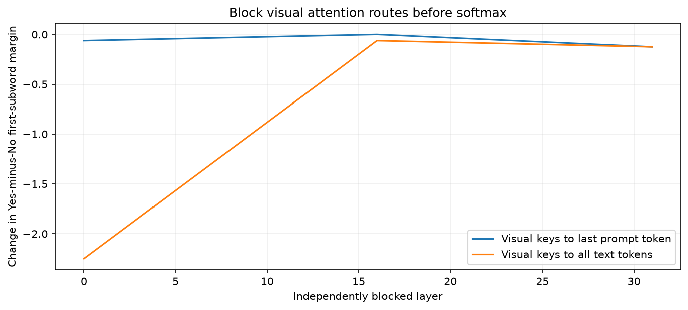

# Attention Knockout

[Home](../../README.md) / [Methods](README.md) / Attention Knockout

Remove selected key-to-query attention routes before softmax and measure the output change. For example, `keys="visual", queries="last_prompt"` tests whether visual attention at the final prompt token supports the selected answer score.

## API and parameters

```text
method = probe.causal.knockout(
    *, layers=None, queries="text", keys="visual", joint=False,
)
result = method.run(inputs, *, metric)
trace = method.forward(inputs, *, capture=())  # joint=True only
```

| Parameter | Default | Meaning and constraints |
| --- | --- | --- |
| `layers` | `None` | All available editable masked-logit layers. Pass one integer or a nonempty unique list. Fused attention and some architectures do not expose these sites. |
| `queries` | `"text"` | Receiver query positions for the blocked links. `"text"` includes chat/system/instruction tokens; it does not mean only the natural-language question. |
| `keys` | `"visual"` | Source key positions to remove from selected queries. Information flows from keys to queries. |
| `joint` | `False` | Default: block each selected layer independently. `True`: block all selected layers in one live forward, so later layers see the changed stream. |
| `inputs` | required | Full native kwargs or `ProbeInputs` with expanded token layout; no KV cache. |
| `metric` | required (`run`) | Output score for intervention minus baseline. See metric contract below. |
| `capture` | `()` (`forward` only) | Hook names to retain in the intervened `ForwardTrace`. `forward` requires `joint=True` and does not compute a baseline. |

Selections use zero-based **expanded model coordinates**, including image tokens. Common token selectors are `"all"`, `"visual"`, `"text"`, `"last_prompt"`, `"prediction"`, an integer/list of positions, or a boolean `[B,T]` mask. `"last_prompt"` selects one final context token; `"prediction"` additionally selects generated positions when `TokenLayout.prompt` preserves the original context. `"visual"`/`"text"` need a visual-token layout. For text-only examples, explicitly choose `tokens="all"` or `"last_prompt"` rather than the visual-token default.

A metric is a `TokenMargin`, `SequenceLogProb`, or a callable `metric(logits)` returning a scalar or `[B]`; it is evaluated on full-sequence logits. `TokenMargin(positive, negative, position="last_prompt")` compares two vocabulary IDs at one selected prediction position. For multi-token answers, explicitly append answer tokens, preserve the original prompt boundary, and use `SequenceLogProb(answer_mask, reduction="sum")` or `"mean"`. First-subword margins are not complete-answer probabilities.

### Computation and returned tensors

Set the chosen masked attention logits to negative infinity. The native softmax renormalizes the remaining permitted keys before value aggregation. This is an actual attention intervention; it does not simply set a displayed heatmap to zero. Blocking every permitted key for a valid query is rejected.

`run()` returns `baseline_score`, `intervention_score`, and `effect = intervention - baseline`. With `joint=False`, each score is `[L,B]` for a per-example metric; with `joint=True`, it is the original metric shape, normally `[B]`. The joint effect is not generally the sum of individual layer effects. `forward()` returns only the live intervened trace, useful when the baseline is already available.

The following complete example uses a real SmolVLM-500M and a raw COCO image. It loads the model (about 1 GB on first download), constructs its native prompt and first-subword answer metric, measures visual routes, and draws a built-in curve. CUDA is recommended. There is no method training.

## Complete example: input to output

```python
import os
import hashlib
import urllib.request
from pathlib import Path
import torch
import matplotlib.pyplot as plt
from PIL import Image
from transformers import AutoModelForImageTextToText, AutoProcessor
from vlmprobe import Prober, TokenMargin
from vlmprobe.visualization import plot_input, plot_intervention_curves

# This recipe targets the SmolVLM/Idefics3 image/chat contract.
# First run downloads the 500M model (~1 GB); CUDA is recommended.
model_id = os.environ.get("VLM_PROBING_MODEL", "HuggingFaceTB/SmolVLM-500M-Instruct")
device = os.environ.get("VLM_PROBING_DEVICE", "cuda:0" if torch.cuda.is_available() else "cpu")
dtype = torch.bfloat16 if device.startswith("cuda") else torch.float32
model = AutoModelForImageTextToText.from_pretrained(
    model_id, dtype=dtype, attn_implementation="eager",
).to(device).eval()
processor = AutoProcessor.from_pretrained(model_id)
probe = Prober(model, processor=processor)
assert model.config.model_type == "idefics3", "Use this recipe with SmolVLM; other models need their native input guide"
print({name: info for name, info in probe.describe()["methods"].items()
       if name.startswith("causal.")})
output_dir = Path(os.environ.get("VLM_PROBING_OUTPUT", "outputs/tutorials/causal"))
output_dir.mkdir(parents=True, exist_ok=True)
# A raw COCO image, not an attribution asset or cached model output.
filename = "COCO_val2014_000000310196.jpg"
expected_sha256 = "0dcc39d91764e59e0e01c11b92ec31320f094a87ca2dce5e0c56c4f1a361daf4"
custom_image = os.environ.get("VLM_PROBING_IMAGE")
root = next((p for p in [Path.cwd(), *Path.cwd().parents]
             if (p / "demos/assets/images" / filename).is_file()), None)
image_path = Path(custom_image) if custom_image else (root / "demos/assets/images" / filename if root else output_dir / filename)
if custom_image and not image_path.is_file():
    raise FileNotFoundError(image_path)
if not image_path.is_file():
    url = "https://s3.amazonaws.com/images.cocodataset.org/val2014/" + filename
    with urllib.request.urlopen(url, timeout=60) as response:
        image_path.write_bytes(response.read())
if not custom_image:
    assert hashlib.sha256(image_path.read_bytes()).hexdigest() == expected_sha256
image = Image.open(image_path).convert("RGB")
question = "Is there a person in this image? Answer yes or no."
messages = [{"role": "user", "content": [
    {"type": "image"}, {"type": "text", "text": question},
]}]
prompt = processor.apply_chat_template(messages, tokenize=False, add_generation_prompt=True)
prepared = probe.prepare(prompt=prompt, image=image, device=device)
# prepare preserves integer fields; cast only floating image inputs for this model.
inputs = {key: value.to(dtype=dtype) if isinstance(value, torch.Tensor) and value.is_floating_point()
          else value for key, value in prepared.kwargs.items()}
positive_ids = processor.tokenizer.encode("Yes", add_special_tokens=False)
negative_ids = processor.tokenizer.encode("No", add_special_tokens=False)
print("Answer subwords:", processor.tokenizer.decode([positive_ids[0]]),
      processor.tokenizer.decode([negative_ids[0]]))
metric = TokenMargin(positive_ids[0], negative_ids[0])
# This targets the first vocabulary subword; it is not complete-answer scoring.
available = sorted(probe.spec.attention_scores)
assert available, "Use an audited eager-attention model for knockout"
layers = sorted({available[0], available[len(available)//2], available[-1]})
curves = {}
for label, queries in [("Visual keys to last prompt token", "last_prompt"),
                       ("Visual keys to all text tokens", "text")]:
    result = probe.causal.knockout(layers=layers, queries=queries,
                                  keys="visual", joint=False).run(inputs, metric=metric)
    curves[label] = result
    print(label, "measured effect:", result.tensors["effect"])
    result.save(output_dir / ("knockout_prediction" if queries == "last_prompt" else "knockout_text"))
ax = plot_intervention_curves(curves, tensor="effect", xlabel="Independently blocked layer",
                              ylabel="Change in Yes-minus-No first-subword margin",
                              title="Block visual attention routes before softmax")
ax.figure.savefig(output_dir / "causal-attention-knockout.png", dpi=150, bbox_inches="tight")
plt.show()
# For a simultaneous multi-layer intervention, configure joint=True explicitly.
joint = probe.causal.knockout(layers=layers, queries="last_prompt", keys="visual", joint=True)
joint_result = joint.run(inputs, metric=metric)
print("Joint effect (not the sum of independent effects):", joint_result.tensors["effect"])
```
### Support and scan interpretation

Editable masked logits require the audited Transformers 5.3 eager Llama, Mistral, Qwen2, Qwen2-VL, Qwen2.5-VL, Qwen3-VL, or Qwen3.5 full-attention contract, including compatible LLaVA/SmolVLM backbones. GPT-2 currently lacks this editable-score tap even though other GPT-2 probes work. SDPA/Flash attention does not expose the required site. Check `describe()` for the loaded model.

For a paper-style nine-layer window, pass the contiguous window as `layers` with `joint=True`; to isolate the question, construct a boolean mask for its exact expanded token span. A `"text"` mask also includes system/chat markers. For complete answer probabilities, use teacher-forced sequence scoring rather than interpreting this first-subword margin as a whole answer.

[Standalone live script](../../examples/tutorials/causal_attention_knockout.py) · [GQA notebook](../../demos/attention_knockout_demo.ipynb) · [Reference](../REFERENCES.md#causal-methods) · [Implementation](../../src/vlm_probing/causal/attention_knockout.py)

## Example visualization

This preview was generated live on **SmolVLM-500M** from the raw COCO image in the code. Each point measures one independently blocked layer; it does not imply a full window scan.


