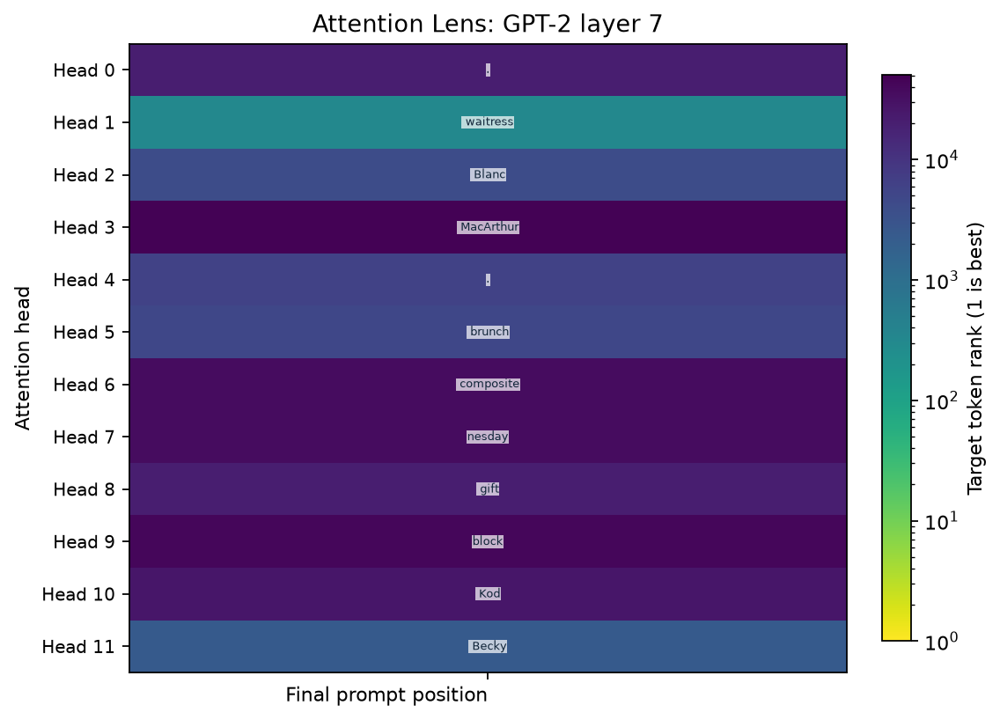

# Attention Lens

[Home](../../README.md) / [Methods](README.md) / Attention Lens

Fit a vocabulary decoder for each attention head and inspect the learned head readouts.

## API and parameters

```text
probe.lens.attention(*, layers=None, tokens="last_prompt", binding=None)
method.fit(inputs, *, steps=100, lr=1e-3,
           initial_unembedding=None, initial_bias=None)
method.run(inputs)
```

| Parameter | Default | Meaning and constraints |
| --- | --- | --- |
| `layers` | `None` | Available **head** layers, not all residual layers. Qwen3.5 exposes only standard-attention layers here. |
| `tokens` | `"last_prompt"` | Matching positions for teacher logits and per-head output vectors. |
| `binding` | `None` | Checkpoint/tokenizer/readout/calibration identities used for saved/loaded decoders. |
| `steps` / `lr` | `100` / `1e-3` | Positive steps / learning rate for one-batch fitting. |
| `initial_unembedding` | `None` | `[V,D]` native output-head weights; new decoders only. Defaults to random decoder initialization. |
| `initial_bias` | `None` | `[V]` native output bias; new decoders only. |
| `inputs` | Required | Prepared calibration/evaluation inputs. |

The adapter captures each head before the shared output projection and projects
its contribution into residual coordinates. Per-head affine decoders are fitted
**jointly through the sum of head logits**, minimizing `KL(model || summed lens)`.
No independent final LayerNorm is applied to each head. This follows the released
author code's training objective; the paper's per-head formula has a different
scope/KL direction. Fixed unembedding head attribution is a separate tool.

Returns `head_logits[L,N,H,V]`, their head sum `logits[L,N,V]` and
`positions[N,2]`. Individual heads are learned readouts; the joint training loss
does not uniquely identify an individual head's independent semantics.

**Memory:** dense decoders contain approximately `H × D × V` weights per layer.
GPT-2 small needs 463 million weights for one layer, before gradients and Adam
states. This example uses one layer; a GPU with ample RAM is recommended. Training checkpoints may occupy roughly 10 GB for this single-layer GPT-2 example. A
missing fitted artifact requires training, not a silent fallback to Logit Lens.

### Dataset training and artifacts

```text
method.fit_batches(train_inputs, validation_inputs, directory,
                   batch_size=64, initial_unembedding=None, initial_bias=None,
                   epochs=10, lr=1e-3, patience=3, min_delta=1e-4,
                   seed=0, resume=True, provenance=None, progress_every=16)
method.save(directory)
method.load(directory)
```

| Parameter | Default | Meaning and constraints |
| --- | --- | --- |
| `train_inputs` | Required | Re-iterable prepared training examples; selected activations/teacher logits are captured once into CPU RAM. |
| `validation_inputs` | Required | Independent examples; split by document/image before tokenization. The library does not deduplicate your dataset. |
| `directory` | Required | Writable artifact/checkpoint directory. Use a fresh directory to start a different experiment. |
| `batch_size` | `64` | Positive number of **selected positions** per decoder minibatch, not input images/prompts. |
| `epochs` | `10` | Positive maximum epochs. |
| `lr` | `1e-3` | Positive Adam learning rate. |
| `patience` | `3` | Positive epochs without sufficient validation improvement before stopping. |
| `min_delta` | `1e-4` | Nonnegative minimum KL improvement; the initial decoder is also a best-checkpoint candidate. |
| `seed` | `0` | Shuffle/training RNG seed. |
| `resume` | `True` | Restore optimizer/RNG/history when matching state exists; identities, data order and configuration must match. |
| `provenance` | `None` | Optional JSON-compatible experiment metadata checked on resume. |
| `progress_every` | `16` | Positive interval (at least `1`) for saving minibatch progress status; epoch summaries are also printed. |
| `initial_unembedding` | `None` | Attention Lens only: initial native output weights `[vocabulary, residual_width]`. Requires new decoders. |
| `initial_bias` | `None` | Attention Lens only: initial native output bias `[vocabulary]`. Requires new decoders. |

The simpler `fit(inputs, steps=100, lr=1e-3)` repeatedly optimizes one batch.
`steps` must be positive; it restarts Adam on every call, whereas `fit_batches`
keeps Adam across minibatches and validates each epoch. Model parameters are not
updated. Neither fitting entry point may run under `torch.inference_mode()`.

`binding` is a caller-declared dictionary with nonempty string `model_id`,
`tokenizer_id`, `readout_id` and `calibration_id`; the adapter adds the capture
`site`. Loading checks these identities and dimensions. Save/load requires
explicit identities; use pinned revisions and dataset-manifest hashes for real
experiments. Bindings are not an automatic hash of checkpoint contents.
`training_history[layer]` includes initial/epoch validation KL, top-1 agreement,
best epoch and `best_validation_kl`. See [training protocol](../TRAINING.md) for
disk-backed caches, author weights and larger datasets.

## Input and coordinate conventions

`inputs` is a native model-input dictionary or `ProbeInputs` from `probe.prepare(...)`.
All examples below are complete scripts; they do not depend on variables from a
model guide. Install `pip install "vlmprobe[transformers,visualization]"` first.
`VLM_PROBING_MODEL` may select a compatible local checkpoint; public defaults use
Hugging Face model IDs. For a VLM, replace only model/processor loading and input
preparation with its [model guide](../models/README.md); the method call and result
contract remain the same wherever `probe.describe()` reports support.

Layer indices are zero-based blocks, measured **after** each block. `None` selects
all available layers; an integer or nonempty list of unique available integers
selects a subset. Shared `tokens` selectors are `"last_prompt"`, `"all"`, `"visual"`,
`"text"`, `"prediction"`, a single expanded position, a sequence of positions, or a boolean
`[batch, expanded_sequence]` mask. `"prediction"` selects the final prompt position and subsequent teacher-forced/generated positions when an explicit prompt mask is supplied. String selectors exclude padding; explicit positions/masks must not select padding. Packed outputs carry
`positions[N,2] = [batch index, expanded token index]`; `N` is not the original
unpadded text length when images add tokens.

## Complete live example

This example trains fresh decoders on independent strings. It downloads GPT-2 if not cached; increase the corpus before treating it as an analysis artifact.

```python
import hashlib
import json
import os
from pathlib import Path

import matplotlib.pyplot as plt
import torch
from transformers import AutoTokenizer, GPT2LMHeadModel
from vlmprobe import Prober
from vlmprobe.visualization import plot_lens_heatmap

# A pretrained text model, not a random architecture or cached probe result.
MODEL_ID = os.environ.get("VLM_PROBING_MODEL", "openai-community/gpt2")
DEVICE = os.environ.get("VLM_PROBING_DEVICE", "cuda:0" if torch.cuda.is_available() else "cpu")
OUT = Path(os.environ.get("VLM_PROBING_OUTPUT", "outputs/lens_tutorial"))
OUT.mkdir(parents=True, exist_ok=True)
torch.manual_seed(0)
model = GPT2LMHeadModel.from_pretrained(MODEL_ID, attn_implementation="eager").to(DEVICE).eval()
tokenizer = AutoTokenizer.from_pretrained(MODEL_ID)
probe = Prober(model, tokenizer)
print(probe.describe())

def prepare(text):
    return probe.prepare(prompt=text, device=DEVICE)

prompt = "When Amy and Laura got a snack at the house, Laura decided to give it to"
inputs = prepare(prompt)
answer_ids = tokenizer.encode(" Amy", add_special_tokens=False)
assert len(answer_ids) == 1, "Choose a single target subword for this rank plot."
answer_id = answer_ids[0]
# Disjoint strings illustrate the protocol; this tiny split is not a quality benchmark.
train_texts = [
    "The child opened a book and began to read.",
    "A red boat crossed the lake before sunset.",
    "The baker placed fresh bread beside the window.",
    "Two friends walked through a quiet garden.",
]
validation_texts = [
    "A musician carried a violin onto the stage.",
    "The train arrived at the station after midnight.",
]
assert not (set(train_texts) & set(validation_texts))
assert prompt not in train_texts + validation_texts
train_inputs = [prepare(text) for text in train_texts]
validation_inputs = [prepare(text) for text in validation_texts]
split_hash = hashlib.sha256(json.dumps([train_texts, validation_texts]).encode()).hexdigest()
binding = {
    "model_id": MODEL_ID + "@" + str(getattr(model.config, "_commit_hash", None) or "local-checkpoint"),
    "tokenizer_id": tokenizer.name_or_path,
    "readout_id": "transformer.ln_f+lm_head",
    "calibration_id": "tutorial-distinct-texts-sha256:" + split_hash,
}
# For a release, pin the model/tokenizer revision and hash the local checkpoint
# if config._commit_hash is unavailable. This binding is caller-declared identity.
# GPT-2: 12 * 768 * 50,257 = 463,168,512 decoder weights per layer.
# Adam/gradients need several times the weight memory; prefer a GPU with ample RAM.
layer = int(os.environ.get("VLM_PROBING_ATTENTION_LAYER", "7"))
assert layer in probe.describe()["methods"]["lens.attention"]["sites"]
lens = probe.lens.attention(layers=[layer], tokens="last_prompt", binding=binding)
head = model.get_output_embeddings()
lens.fit_batches(train_inputs, validation_inputs, OUT / "attention-artifact",
                 initial_unembedding=head.weight, initial_bias=getattr(head, "bias", None),
                 batch_size=4, epochs=2, lr=1e-4, patience=2, seed=0,
                 resume=False)
result = lens.run(inputs)
print("head logits [layer, packed position, head, vocabulary]:", result.tensors["head_logits"].shape)
print("summed logits:", result.tensors["logits"].shape)
# Put the measured heads on rows; this is not a layer axis.
head_logits = result.tensors["head_logits"][0].permute(1, 0, 2)
fig, ax = plt.subplots(figsize=(7, 5), layout="constrained")
ax = plot_lens_heatmap(head_logits, ax=ax, target_token_id=answer_id,
                       layer_labels=[f"Head {i}" for i in range(head_logits.shape[0])],
                       token_labels=["Final prompt position"], tokenizer=tokenizer,
                       title=f"Attention Lens: GPT-2 layer {layer}")
ax.set_ylabel("Attention head")
ax.tick_params(axis="y", labelsize=9)
ax.tick_params(axis="x", labelrotation=0)
ax.set_xlabel("")
ax.figure.savefig(OUT / "attention.png", dpi=160, bbox_inches="tight")
plt.show()
print("best held-out KL:", lens.training_history[layer]["best_validation_kl"])
restored = probe.lens.attention(layers=[layer], binding=binding).load(OUT / "attention-artifact")
```

Run the same code as a script: [lens_attention.py](../../examples/tutorials/lens_attention.py).

## Output and visualization

Each row is one head at a single decoder layer. Colors rank the same target subword; annotations are the learned decoder top-1 subword. The displayed heads are not residual layers and are not additive causal attributions. Tiny-split fitting is not a claim of stable head semantics.



The preview is generated by the live tutorial, not a loaded measurement snapshot.
[Checkpoint hashes, data split and run provenance](../assets/tutorials/lens-provenance.json).
[Source/reference](../REFERENCES.md#lens-methods) · [Training and artifact protocol](../TRAINING.md).
