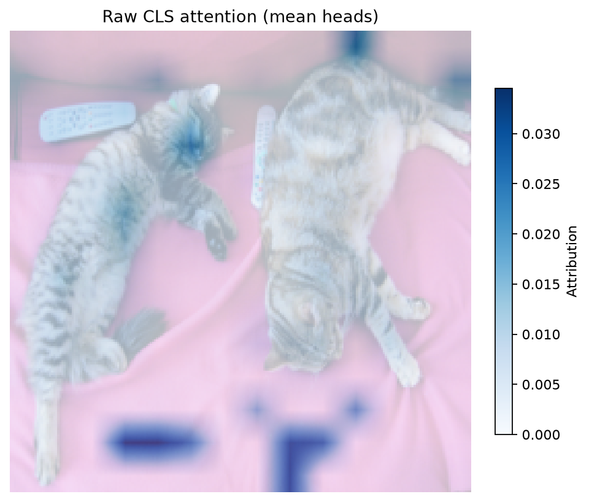

# Attention Profile

[Home](../../README.md) / [Methods](README.md) / Attention Profile

Measure attention entropy, concentration, and mass assigned to explicitly chosen token groups. This describes where probability mass goes; it does not establish answer dependence.

## API and parameters

```text
method = probe.attention.profile(*, layers=None, queries="all", groups=None, include_attention=False)
result = method.run(inputs, *, metric=None)
```

| Parameter | Default | Meaning and constraints |
| --- | --- | --- |
| `layers` | `None` | All supported attention layers by default; an integer or a nonempty unique selection chooses a subset. Qwen3.5 only exposes full-attention layers here. |
| `queries` | `"all"` | Query token selector. Unselected query statistics are zero and explicitly marked in `valid_queries`. |
| `groups` | `None` | Optional `{name: key_selector}`. Groups must be disjoint; ungrouped keys are allowed. With a visual layout, the default is visual/text groups; without one, no groups. |
| `include_attention` | `False` | Also retain raw probabilities `[L,B,H,T,T]`; memory is quadratic in sequence length. |
| `inputs` | `required` | Prepared native model kwargs or `ProbeInputs` matching the bound model. |
| `metric` | `None` | Accepted by the common runner but unused for this observational method; omit it. |

`inputs` is a native model-kwargs dictionary or `ProbeInputs`; pass every processor field, not just token IDs. Layer indices are zero-based model indices (not plot row numbers). A selection is an integer or a nonempty list of unique supported indices. Token selectors accept `"all"`, `"visual"`, `"text"`, `"last_prompt"`, `"prediction"`, nonnegative expanded-sequence positions, or a boolean `[B,T]` mask. Padding cannot be selected. For VLMs these positions include expanded image slots, not just tokenizer text positions.

Results are detached CPU `ProbeResult` tensors by default; `result.save(path)` stores tensors and JSON-safe run metadata. `B/H/T/V/L` denote batch/head/token/vocabulary/selected-layer axes. Check `probe.describe()["methods"][method_name]` for the actual checkpoint. Eager attention and no KV cache are required for these model-bound attention methods.

## Complete example

The example loads pretrained weights, reads a raw image, computes a fresh result, and calls the built-in visualization API. No probe training is required. Run outside `torch.inference_mode()` for gradient methods.

```python
from pathlib import Path
import os
from io import BytesIO
from urllib.request import urlopen
import numpy as np
import torch
from PIL import Image
from transformers import AutoImageProcessor, ViTForImageClassification
from vlmprobe import Prober, ClassScore
from vlmprobe import visualization as viz
import matplotlib.pyplot as plt

# Install: pip install "vlmprobe[transformers,visualization]"
# Set VLM_PROBING_MODEL to a local directory to avoid downloading this checkpoint.
model_id = os.environ.get("VLM_PROBING_MODEL", "google/vit-base-patch16-224")
device = os.environ.get("VLM_PROBING_DEVICE", "cuda:0" if torch.cuda.is_available() else "cpu")
model = ViTForImageClassification.from_pretrained(model_id, attn_implementation="eager").to(device).eval()
processor = AutoImageProcessor.from_pretrained(os.environ.get("VLM_PROBING_PROCESSOR", model_id))
probe = Prober(model, processor)

# A raw COCO image, not a saved attention map or a previous model result.
image_path = os.environ.get("VLM_PROBING_IMAGE")
image = (Image.open(image_path) if image_path else Image.open(BytesIO(urlopen(
    "https://huggingface.co/datasets/huggingface/documentation-images/resolve/main/coco_sample.png"
).read()))).convert("RGB")
inputs = {k: v.to(device) for k, v in processor(images=image, return_tensors="pt").items()}
with torch.no_grad():
    logits = model(**inputs).logits
    target_id = int(logits[0].argmax())  # Choose once; keep fixed during attribution.
metric = ClassScore(target_id, kind="logit")
print("Fixed target:", target_id, model.config.id2label.get(target_id))

# Plot the actual processed image; its crop/resize aligns with the patch tokens.
mean = torch.tensor(processor.image_mean)[:, None, None]
std = torch.tensor(processor.image_std)[:, None, None]
rgb = (inputs["pixel_values"][0].detach().cpu() * std + mean).clamp(0, 1)
processed_image = Image.fromarray((rgb.permute(1, 2, 0).numpy() * 255).astype("uint8"))
patch = model.config.patch_size
grid_shape = tuple(int(n // patch) for n in inputs["pixel_values"].shape[-2:])
visual_positions = list(range(1, 1 + grid_shape[0] * grid_shape[1]))  # CLS is 0.
last = probe.describe()["methods"]["attention.profile"]["sites"][-1]
output_dir = Path(os.environ.get("VLM_PROBING_OUTPUT", "outputs/attention-tutorial"))
output_dir.mkdir(parents=True, exist_ok=True)
result = probe.attention.profile(
    layers=[last], queries=[0], groups={"patches": "visual", "cls": [0]},
    include_attention=True,
).run(inputs)
print("Entropy [L,B,H,Q]:", result.tensors["entropy"].shape)
print("Selected query entropy:", result.tensors["entropy"][0, 0, :, 0])
print("Group order:", result.metadata["layer_results"][0]["groups"])
ax = viz.plot_attention_overlay(
    processed_image, result, tensor="attention", grid_shape=grid_shape,
    visual_positions=visual_positions, query_positions=[0],
    signed=False, image_alpha=0.25, alpha=1.0,
    title="Raw CLS attention (mean heads)",
)
ax.figure.savefig(output_dir / "attention-profile.png", dpi=160, bbox_inches="tight")
result.save(output_dir / "attention-profile")
plt.show()
```



The preview was generated by this tutorial, not loaded as its input. See the [execution manifest](../assets/tutorials/attention-execution.json) for the checkpoint, target and settings.

## Outputs and interpretation

`entropy`, `concentration`, `max_probability`: `[L,B,H,T]`; entropy uses natural logs. `group_mass[L,B,H,T,G]` is present when groups exist. `valid_queries[L,B,T]` distinguishes unselected rows from measured zero values. With `include_attention=True`, `attention[L,B,H,T,T]` supplies the plotted raw map. Head averaging is only a display choice.

## Support and references

Use the same factory calls on another supported checkpoint after changing only model loading and preprocessing in its [model guide](../models/README.md). Hybrid Qwen3.5 supports individual full-attention layers, but rollout/relevance/TAM/Beyond Intuition cannot skip its intervening linear-attention blocks. An all-zero measured map is valid; an unavailable method is a capability error, not a zero map.

[Implementation](../../src/vlm_probing/attention/profile.py) · [Supporting primitives](../REFERENCES.md#supporting-primitives)
