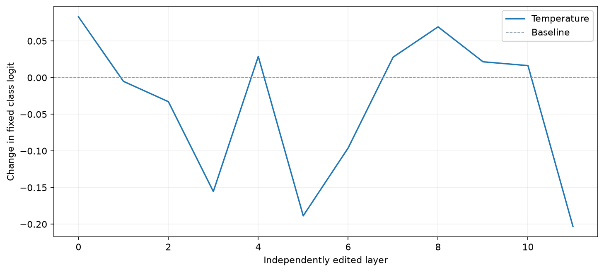

# Attention Temperature

[Home](../../README.md) / [Methods](README.md) / Attention Temperature

Change attention sharpness inside the model and measure the score change. This is not generation/sampling temperature.

## API and parameters

```text
method = probe.attention.temperature(*, layers=None, queries="all", temperature=1.0)
result = method.run(inputs, *, metric=None)
```

| Parameter | Default | Meaning and constraints |
| --- | --- | --- |
| `layers` | `None` | All adapter-declared editable pre-softmax score layers; select a unique supported subset. |
| `queries` | `"all"` | Rows whose masked attention logits are divided by the temperature. |
| `temperature` | `1.0` | Finite strictly positive scalar. Below 1 sharpens attention; above 1 softens it; 1 is an identity control. |
| `inputs` | `required` | Prepared native model kwargs or `ProbeInputs` matching the bound model. |
| `metric` | `None; required` | A fixed `ClassScore`, `TokenMargin`, `SequenceLogProb`, or callable returning a finite scalar or `[B]`. These measured reruns do not require score gradients. |

`inputs` is a native model-kwargs dictionary or `ProbeInputs`; pass every processor field, not just token IDs. Layer indices are zero-based model indices (not plot row numbers). A selection is an integer or a nonempty list of unique supported indices. Token selectors accept `"all"`, `"visual"`, `"text"`, `"last_prompt"`, `"prediction"`, nonnegative expanded-sequence positions, or a boolean `[B,T]` mask. Padding cannot be selected. For VLMs these positions include expanded image slots, not just tokenizer text positions.

Results are detached CPU `ProbeResult` tensors by default; `result.save(path)` stores tensors and JSON-safe run metadata. `B/H/T/V/L` denote batch/head/token/vocabulary/selected-layer axes. Check `probe.describe()["methods"][method_name]` for the actual checkpoint. Eager attention and no KV cache are required for these model-bound attention methods.

## Complete example

The example loads pretrained weights, reads a raw image, computes a fresh result, and calls the built-in visualization API. No probe training is required. Run outside `torch.inference_mode()` for gradient methods.

```python
from pathlib import Path
import os
from io import BytesIO
from urllib.request import urlopen
import numpy as np
import torch
from PIL import Image
from transformers import AutoImageProcessor, ViTForImageClassification
from vlmprobe import Prober, ClassScore
from vlmprobe import visualization as viz
import matplotlib.pyplot as plt

# Install: pip install "vlmprobe[transformers,visualization]"
# Set VLM_PROBING_MODEL to a local directory to avoid downloading this checkpoint.
model_id = os.environ.get("VLM_PROBING_MODEL", "google/vit-base-patch16-224")
device = os.environ.get("VLM_PROBING_DEVICE", "cuda:0" if torch.cuda.is_available() else "cpu")
model = ViTForImageClassification.from_pretrained(model_id, attn_implementation="eager").to(device).eval()
processor = AutoImageProcessor.from_pretrained(os.environ.get("VLM_PROBING_PROCESSOR", model_id))
probe = Prober(model, processor)

# A raw COCO image, not a saved attention map or a previous model result.
image_path = os.environ.get("VLM_PROBING_IMAGE")
image = (Image.open(image_path) if image_path else Image.open(BytesIO(urlopen(
    "https://huggingface.co/datasets/huggingface/documentation-images/resolve/main/coco_sample.png"
).read()))).convert("RGB")
inputs = {k: v.to(device) for k, v in processor(images=image, return_tensors="pt").items()}
with torch.no_grad():
    logits = model(**inputs).logits
    target_id = int(logits[0].argmax())  # Choose once; keep fixed during attribution.
metric = ClassScore(target_id, kind="logit")
print("Fixed target:", target_id, model.config.id2label.get(target_id))

# Plot the actual processed image; its crop/resize aligns with the patch tokens.
mean = torch.tensor(processor.image_mean)[:, None, None]
std = torch.tensor(processor.image_std)[:, None, None]
rgb = (inputs["pixel_values"][0].detach().cpu() * std + mean).clamp(0, 1)
processed_image = Image.fromarray((rgb.permute(1, 2, 0).numpy() * 255).astype("uint8"))
patch = model.config.patch_size
grid_shape = tuple(int(n // patch) for n in inputs["pixel_values"].shape[-2:])
visual_positions = list(range(1, 1 + grid_shape[0] * grid_shape[1]))  # CLS is 0.
last = probe.describe()["methods"]["attention.profile"]["sites"][-1]
output_dir = Path(os.environ.get("VLM_PROBING_OUTPUT", "outputs/attention-tutorial"))
output_dir.mkdir(parents=True, exist_ok=True)
result = probe.attention.temperature(layers=list(range(last + 1)), queries=[0], temperature=0.7).run(inputs, metric=metric)
print("Baseline:", result.tensors["baseline_score"])
print("Edited:", result.tensors["intervention_score"])
print("Effect:", result.tensors["effect"])
ax = viz.plot_intervention_curves(
    {"Temperature": result}, tensor="effect", baseline=0,
    xlabel="Independently edited layer", ylabel="Change in fixed class logit",
)
ax.figure.savefig(output_dir / "attention-temperature.png", dpi=160, bbox_inches="tight")
result.save(output_dir / "attention-temperature")
plt.show()
```



The preview was generated by this tutorial, not loaded as its input. See the [execution manifest](../assets/tutorials/attention-execution.json) for the checkpoint, target and settings.

## Outputs and interpretation

Each selected layer is edited in a **separate run**, not jointly. `baseline_score[L,B]`, `intervention_score[L,B]`, and `effect[L,B]` use `effect = intervention - baseline`; positive means the edit increased the selected score. The model is restored after each run. Compare identity controls before interpreting an effect. Temperature divides actual masked pre-softmax scores and preserves forbidden entries. It requires a score edit hook; observable probabilities alone are insufficient.

## Support and references

Use the same factory calls on another supported checkpoint after changing only model loading and preprocessing in its [model guide](../models/README.md). Hybrid Qwen3.5 supports individual full-attention layers, but rollout/relevance/TAM/Beyond Intuition cannot skip its intervening linear-attention blocks. An all-zero measured map is valid; an unavailable method is a capability error, not a zero map.

This is a generic intervention primitive, not a claimed reproduction of PAI/VAR or another full decoding algorithm. [Source and related work](../REFERENCES.md#supporting-primitives)
