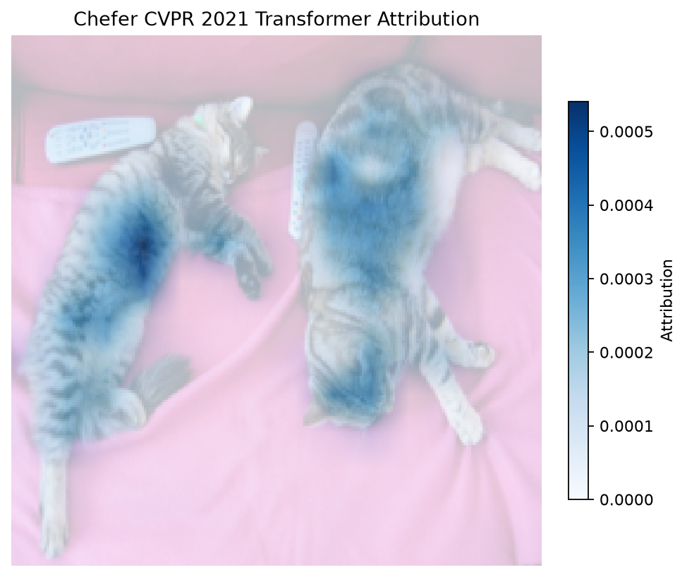

# Chefer Transformer Attribution (DTD/LRP)

[Home](../../README.md) / [Methods](README.md) / Chefer Transformer Attribution (DTD/LRP)

Run the CVPR 2021 author-rule relevance backend on a native ViT classifier. This propagates relevance through the actual ViT operations; forward probabilities alone are insufficient.

## API and parameters

`probe` is a `Prober` bound to a loaded ViT classifier; `pixel_values` is its processed image tensor. The blocks below are API signatures: `*` marks keyword-only parameters, not an argument to copy. The [complete example](#complete-example) defines the model, inputs, and all other variables before running the method.

```text
method = probe.attention.dtd_lrp(*, method="transformer_attribution", start_layer=0, device=None)
result = method.run(pixel_values, *, target=None)
```

| Parameter | Default | Meaning and constraints |
| --- | --- | --- |
| `method` | `"transformer_attribution"` | CVPR proposed method. Also accepts `"last_layer"` (final-layer CAM) and `"full"` (pixel relevance under the same Chefer rules). These are not the paper’s separate conventional/partial LRP baseline implementations. |
| `start_layer` | `0` | Zero-based first layer included in Transformer Attribution aggregation; must be an existing layer. Record this setting when comparing results. |
| `device` | `None` | Keep the source classifier device, or move the copied backend to the requested device. Supply pixels on the same device and dtype. |
| `pixel_values` | `required` | Finite floating `[B,C,H,W]` processed pixels matching the native ViT input channels and configured image size; not a processor dictionary. |
| `target` | `None` | `None`: each image’s top class; an integer: one fixed class for all examples; long `[B]` tensor: explicit class per image. Indices must be in range. |

`inputs` is a native model-kwargs dictionary or `ProbeInputs`; pass every processor field, not just token IDs. Layer indices are zero-based model indices (not plot row numbers). A selection is an integer or a nonempty list of unique supported indices. Token selectors accept `"all"`, `"visual"`, `"text"`, `"last_prompt"`, `"prediction"`, nonnegative expanded-sequence positions, or a boolean `[B,T]` mask. Padding cannot be selected. For VLMs these positions include expanded image slots, not just tokenizer text positions.

Results are detached CPU `ProbeResult` tensors by default; `result.save(path)` stores tensors and JSON-safe run metadata. `B/H/T/V/L` denote batch/head/token/vocabulary/selected-layer axes. Check `probe.describe()["methods"][method_name]` for the actual checkpoint. Eager attention and no KV cache are required for these model-bound attention methods.

## Complete example

The example loads pretrained weights, reads a raw image, computes a fresh result, and calls the built-in visualization API. No probe training is required. Run outside `torch.inference_mode()` for gradient methods.

```python
from pathlib import Path
import os
from io import BytesIO
from urllib.request import urlopen
import numpy as np
import torch
from PIL import Image
from transformers import AutoImageProcessor, ViTForImageClassification
from vlmprobe import Prober, ClassScore
from vlmprobe import visualization as viz
import matplotlib.pyplot as plt

# Install: pip install "vlmprobe[transformers,visualization]"
# Set VLM_PROBING_MODEL to a local directory to avoid downloading this checkpoint.
model_id = os.environ.get("VLM_PROBING_MODEL", "google/vit-base-patch16-224")
device = os.environ.get("VLM_PROBING_DEVICE", "cuda:0" if torch.cuda.is_available() else "cpu")
model = ViTForImageClassification.from_pretrained(model_id, attn_implementation="eager").to(device).eval()
processor = AutoImageProcessor.from_pretrained(os.environ.get("VLM_PROBING_PROCESSOR", model_id))
probe = Prober(model, processor)

# A raw COCO image, not a saved attention map or a previous model result.
image_path = os.environ.get("VLM_PROBING_IMAGE")
image = (Image.open(image_path) if image_path else Image.open(BytesIO(urlopen(
    "https://huggingface.co/datasets/huggingface/documentation-images/resolve/main/coco_sample.png"
).read()))).convert("RGB")
inputs = {k: v.to(device) for k, v in processor(images=image, return_tensors="pt").items()}
with torch.no_grad():
    logits = model(**inputs).logits
    target_id = int(logits[0].argmax())  # Choose once; keep fixed during attribution.
metric = ClassScore(target_id, kind="logit")
print("Fixed target:", target_id, model.config.id2label.get(target_id))

# Plot the actual processed image; its crop/resize aligns with the patch tokens.
mean = torch.tensor(processor.image_mean)[:, None, None]
std = torch.tensor(processor.image_std)[:, None, None]
rgb = (inputs["pixel_values"][0].detach().cpu() * std + mean).clamp(0, 1)
processed_image = Image.fromarray((rgb.permute(1, 2, 0).numpy() * 255).astype("uint8"))
patch = model.config.patch_size
grid_shape = tuple(int(n // patch) for n in inputs["pixel_values"].shape[-2:])
visual_positions = list(range(1, 1 + grid_shape[0] * grid_shape[1]))  # CLS is 0.
last = probe.describe()["methods"]["attention.profile"]["sites"][-1]
output_dir = Path(os.environ.get("VLM_PROBING_OUTPUT", "outputs/attention-tutorial"))
output_dir.mkdir(parents=True, exist_ok=True)
method = probe.attention.dtd_lrp(method="transformer_attribution", start_layer=0, device=device)
result = method.run(inputs["pixel_values"], target=target_id)
print("Patch map:", result.tensors["patch_relevance"].shape)
# The converted author-rule backend must keep the native classifier predictions.
with torch.no_grad():
    native_logits = model(**inputs).logits.cpu()
torch.testing.assert_close(result.tensors["logits"], native_logits, rtol=1e-4, atol=1e-4)
ax = viz.plot_attention_overlay(
    processed_image, result, tensor="patch_relevance", image_alpha=0.25,
    signed=bool((result.tensors["patch_relevance"] < 0).any()),
    title="Chefer CVPR 2021 Transformer Attribution",
)
ax.figure.savefig(output_dir / "attention-chefer.png", dpi=160, bbox_inches="tight")
result.save(output_dir / "attention-chefer")
plt.show()
```



The preview was generated by this tutorial, not loaded as its input. See the [execution manifest](../assets/tutorials/attention-execution.json) for the checkpoint, target and settings.

## Outputs and interpretation

`logits[B,C]`, selected `target[B]`, `attention_relevance[L,B,H,T,T]`, and `attention_gradients[L,B,H,T,T]` are returned. Non-`full` modes include `patch_relevance[B,grid_h,grid_w]`; `full` returns pixel relevance in `relevance`. Batches are processed as independent single-image relevance runs to match author normalization. Transformer Attribution combines positive `R_attention * dScore/dA`, averages heads and recursively propagates residual relevance without row normalization. The converted backend copies weights and LayerNorm epsilon; it does not train or modify the native model.

## Support and references

Supports native Hugging Face `ViTForImageClassification` with exact GELU and a linear classifier, not arbitrary LLM/VLM decoders. Run outside `torch.inference_mode()`. For generic self-attention recurrence use [Attention Relevance](attention_relevance.md).

[Transformer Interpretability Beyond Attention Visualization](https://arxiv.org/abs/2012.09838) · [Pinned author-rule provenance](../../src/vlm_probing/_vendor/chefer2021/README.md) · [Wrapper](../../src/vlm_probing/attention/lrp.py)
