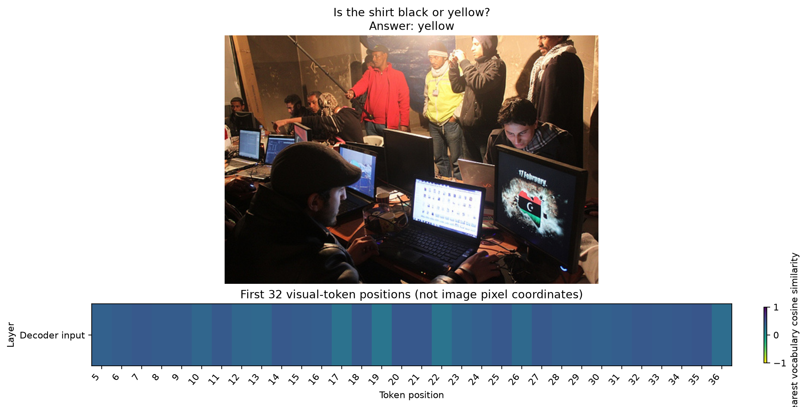

# EmbedLens

[Home](../../README.md) / [Methods](README.md) / EmbedLens

Inspect the vocabulary embeddings nearest to projected visual tokens.

## API and parameters

`probe` is a `Prober` bound to a loaded model; `inputs` contains prepared model inputs. The blocks below are API signatures: `*` marks keyword-only parameters, not an argument to copy. The [complete example](#complete-live-example) defines the model, inputs, and all other variables before running the method.

```text
method = probe.lens.embed(*, tokens="visual", token_groups=None)
result = method.run(inputs, *, top_k=10, vocabulary_chunk_size=8192)
```

| Parameter | Default | Meaning and constraints |
| --- | --- | --- |
| `tokens` | `"visual"` | Positions in the decoder's merged input-embedding sequence. Other common selectors work; pure text models must use `"text"`/`"all"` or explicit positions. |
| `token_groups` | `None` | Optional `{group_name: [vocabulary IDs]}`. Names/groups must be nonempty, IDs valid and groups disjoint. Labels classify the nearest ID only. |
| `inputs` | Required | Native model inputs or `ProbeInputs`, including all native image/crop/mask fields. |
| `top_k` | `10` | Integer from `1` to vocabulary size; number of nearest vocabulary embeddings per selected position. |
| `vocabulary_chunk_size` | `8192` | Positive number of embedding rows processed at once. Reduces temporary memory without approximating top-k search. |

Returns `token_ids[1,N,K]`, cosine `similarities[1,N,K]`,
`activation_norms[1,N]`, `positions[N,2]` and optional `group_labels[1,N]`.
The leading dimension identifies the **single decoder-input embedding site**, not
a stack of decoder layers. `group_names` is saved in layer-result metadata;
unmatched labels are `-1`, not a universal "alive" class.

No training, probability head or vocabulary filtering is applied. The adapter
captures the decoder input **after visual/text merging** and compares normalized
vectors against the model's native input embedding table. This is semantic
nearest-neighbor readout; the paper's full clustering/pruning pipeline is not
implemented by this call.

## Input and coordinate conventions

`inputs` is a native model-input dictionary or `ProbeInputs` from `probe.prepare(...)`.
All examples below are complete scripts; they do not depend on variables from a
model guide. Install `pip install "vlmprobe[transformers,visualization]"` first.
`VLM_PROBING_MODEL` may select a compatible local checkpoint; public defaults use
Hugging Face model IDs. For a VLM, replace only model/processor loading and input
preparation with its [model guide](../models/README.md); the method call and result
contract remain the same wherever `probe.describe()` reports support.

This method has no `layers` argument: it reads the decoder-input embedding
sequence. `tokens` accepts `"last_prompt"`, `"all"`, `"visual"`, `"text"`,
`"prediction"`, an expanded position/list or a boolean `[B,T]` mask. Explicit
positions must not select padding. `positions[N,2]` maps selected rows to
`[batch, expanded-token position]`, including any visual slots. A custom
`VLM_PROBING_IMAGE` must name an existing image; edit `question` to match it.
Only the default GQA image is checked against the bundled source hash.

## Complete live example

This downloads a small pretrained VLM and a raw GQA image if absent. It computes
fresh visual embeddings and nearest neighbors; it never loads saved probe results.
GPU use is recommended, while CPU runs use float32.

```python
import hashlib
import os
from pathlib import Path
from urllib.request import urlretrieve

import matplotlib.pyplot as plt
import torch
from PIL import Image
from transformers import AutoModelForImageTextToText, AutoProcessor
from vlmprobe import Prober
from vlmprobe.visualization import plot_input, plot_lens_heatmap

MODEL_ID = os.environ.get("VLM_PROBING_MODEL", "HuggingFaceTB/SmolVLM-500M-Instruct")
DEVICE = os.environ.get("VLM_PROBING_DEVICE", "cuda:0" if torch.cuda.is_available() else "cpu")
OUT = Path(os.environ.get("VLM_PROBING_OUTPUT", "outputs/embed_tutorial"))
OUT.mkdir(parents=True, exist_ok=True)
custom_image = os.environ.get("VLM_PROBING_IMAGE")
image_path = Path(custom_image) if custom_image else OUT / "2341576.jpg"
if custom_image and not image_path.is_file():
    raise FileNotFoundError(image_path)
if not image_path.is_file():
    urlretrieve("https://raw.githubusercontent.com/gexinh/vlm-probing/main/demos/assets/images/2341576.jpg", image_path)
if not custom_image:
    assert hashlib.sha256(image_path.read_bytes()).hexdigest() == "f2f5880022dce631fd23240b2d690a56dd1fa551205c48b16db210b147d2f968"
image = Image.open(image_path).convert("RGB")
question = "Is the shirt black or yellow?"
model = AutoModelForImageTextToText.from_pretrained(
    MODEL_ID, dtype=torch.float32, attn_implementation="eager",
).to(DEVICE).eval()
processor = AutoProcessor.from_pretrained(MODEL_ID)
probe = Prober(model, processor)
print(probe.describe())
messages = [{"role": "user", "content": [
    {"type": "image"}, {"type": "text", "text": question},
]}]
prompt = processor.apply_chat_template(messages, tokenize=False, add_generation_prompt=True)
inputs = probe.prepare(prompt=prompt, image=image, device=DEVICE)
result = probe.lens.embed(tokens="visual").run(inputs, top_k=5, vocabulary_chunk_size=4096)
print("neighbors / cosine:", result.tensors["token_ids"].shape, result.tensors["similarities"].shape)
print("coordinates:", result.tensors["positions"].shape)
for position, ids, cosine in zip(result.tensors["positions"][:8],
                                result.tensors["token_ids"][0, :8],
                                result.tensors["similarities"][0, :8]):
    print(position.tolist(), [(processor.tokenizer.decode([int(i)]), round(float(s), 3))
                              for i, s in zip(ids, cosine)])
# Geometry is not guessed: crops/tiles are model-specific. Display exact token
# coordinates rather than stretching a multi-crop sequence over the raw image.
count = min(32, result.tensors["positions"].shape[0])
fig, axes = plt.subplots(2, 1, figsize=(12, 6), height_ratios=[4, 1], constrained_layout=True)
plot_input(image, prompt=question, answer="yellow" if not custom_image else None, ax=axes[0])
plot_lens_heatmap(result.tensors["similarities"][0, :count, 0][None],
                  value_kind="logit", log_scale=False, vmin=-1, vmax=1,
                  layer_labels=["Decoder input"],
                  token_labels=result.tensors["positions"][:count, 1].tolist(),
                  ax=axes[1], value_label="Nearest vocabulary cosine similarity",
                  title="First 32 visual-token positions (not image pixel coordinates)")
fig.savefig(OUT / "embed.png", dpi=160, bbox_inches="tight")
plt.show()
result.save(OUT / "embed-result")
```

Run as [lens_embed.py](../../examples/tutorials/lens_embed.py). The
[VLM notebook](../../demos/vlm_lens_demo.ipynb) also shows Logit/Tuned Lens
and an explicitly prepared Patchscope target on the same model.

## Output and visualization

The figure shows the actual input and nearest-neighbor cosine for the first 32
selected visual positions. These columns are expanded token positions, not image
pixels. Multi-crop processors require explicit crop-to-image geometry before an
overlay; the tutorial does not guess a square grid or stretch tiled tokens.



[Checkpoint hashes, input checksum and run provenance](../assets/tutorials/lens-provenance.json).


A nearest word is always returned even for a poor match; read the cosine values
and the complete top-k list. Cosine similarity is not a next-token probability,
object detection, or causal evidence. Multilingual/special vocabulary fragments
are preserved rather than translated or relabeled.

[Source/reference](../REFERENCES.md#lens-methods) · [Full VLM walkthrough](../../demos/vlm_lens_demo.ipynb).
