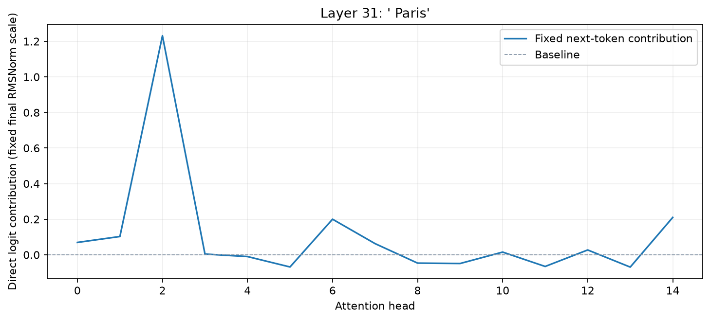

# Head Logit Attribution

[Home](../../README.md) / [Methods](README.md) / Head Logit Attribution

Project attention-head outputs into the vocabulary under one fixed final normalization scale. These are direct additive contributions, not trained head decoders or causal ablations.

## API and parameters

`probe` is a `Prober` bound to a loaded model; `inputs` contains prepared model inputs. The blocks below are API signatures: `*` marks keyword-only parameters, not an argument to copy. The [complete example](#complete-example) defines the model, inputs, and all other variables before running the method.

```text
method = probe.attention.head_logits(*, layers=None)
result = method.run(inputs, *, metric=None)
```

| Parameter | Default | Meaning and constraints |
| --- | --- | --- |
| `layers` | `None` | All layers with projected heads and an adapter-declared fixed-scale linear readout, or a unique supported subset. Begin with one layer and a short prompt: output size is `[L,B,H,T,V]`. |
| `inputs` | `required` | Prepared native model kwargs or `ProbeInputs` matching the bound model. |
| `metric` | `None` | Accepted by the common runner but unused; the result contains contributions for the whole vocabulary. |

`inputs` is a native model-kwargs dictionary or `ProbeInputs`; pass every processor field, not just token IDs. Layer indices are zero-based model indices (not plot row numbers). A selection is an integer or a nonempty list of unique supported indices. Token selectors accept `"all"`, `"visual"`, `"text"`, `"last_prompt"`, `"prediction"`, nonnegative expanded-sequence positions, or a boolean `[B,T]` mask. Padding cannot be selected. For VLMs these positions include expanded image slots, not just tokenizer text positions.

Results are detached CPU `ProbeResult` tensors by default; `result.save(path)` stores tensors and JSON-safe run metadata. `B/H/T/V/L` denote batch/head/token/vocabulary/selected-layer axes. Check `probe.describe()["methods"][method_name]` for the actual checkpoint. Eager attention and no KV cache are required for these model-bound attention methods.

## Complete example

The example loads pretrained weights, reads a raw image, computes a fresh result, and calls the built-in visualization API. No probe training is required. Run outside `torch.inference_mode()` for gradient methods.

```python
from pathlib import Path
import os
import torch
from transformers import AutoModelForImageTextToText, AutoProcessor
from vlmprobe import Prober
from vlmprobe import visualization as viz
import matplotlib.pyplot as plt

# Install: pip install "vlmprobe[transformers,visualization]"
model_id = os.environ.get("VLM_PROBING_MODEL", "HuggingFaceTB/SmolVLM-500M-Instruct")
device = os.environ.get("VLM_PROBING_DEVICE", "cuda:0" if torch.cuda.is_available() else "cpu")
model = AutoModelForImageTextToText.from_pretrained(
    model_id, dtype=torch.float32, attn_implementation="eager",
).to(device).eval()
processor = AutoProcessor.from_pretrained(model_id)
probe = Prober(model, processor)
prompt = "The capital of France is"
inputs = probe.prepare(prompt=prompt, device=device)  # This VLM also accepts text-only inputs.
capability = probe.describe()["methods"]["attention.head_logits"]
assert capability["available"], capability["missing"]
layer = capability["sites"][-1]
result = probe.attention.head_logits(layers=[layer]).run(inputs)
print("Head logits [L,B,H,T,V]:", result.tensors["head_logits"].shape)
last_position = int(inputs.kwargs["attention_mask"][0].nonzero()[-1])
# Show each head's top direct vocabulary contributions at one prediction row.
head_scores = result.tensors["head_logits"][0, 0, :, last_position, :]
for head, scores in enumerate(head_scores):
    token_ids = scores.topk(3).indices.tolist()
    print(head, [(processor.tokenizer.decode([i]), float(scores[i])) for i in token_ids])
with torch.no_grad():
    target_id = int(model(**inputs.kwargs).logits[0, last_position].argmax())
curves = {"Fixed next-token contribution": {
    "x": list(range(head_scores.shape[0])), "y": head_scores[:, target_id].numpy(),
}}
ax = viz.plot_intervention_curves(curves, baseline=0, xlabel="Attention head",
    ylabel="Direct logit contribution (fixed final RMSNorm scale)",
    title=f"Layer {layer}: {processor.tokenizer.decode([target_id])!r}")
# Only the plot function is reused: these are observational contributions, not interventions.
output_dir = Path(os.environ.get("VLM_PROBING_OUTPUT", "outputs/attention-head-logits"))
output_dir.mkdir(parents=True, exist_ok=True)
result.save(output_dir / "head-logits")
ax.figure.savefig(output_dir / "attention-head-logits.png", dpi=160, bbox_inches="tight")
plt.show()
```



The preview was generated by this tutorial, not loaded as its input. See the [execution manifest](../assets/tutorials/attention-execution.json) for the checkpoint, target and settings.

## Outputs and interpretation

`head_logits[L,B,H,T,V]` and `summed_logits[L,B,T,V]` use projected head values after `W_O`. The final residual’s normalization denominator and norm gain are shared across heads; biases are excluded. Summation reproduces this specified linear readout of the supplied head sum, not a full decomposition of final output logits. Downstream responses to changing a head are absent. The example uses the built-in curve renderer for signed contributions and labels its observational meaning explicitly.

## Support and references

Available on supported RMSNorm language/VLM backbones, including gated Qwen3.5 full-attention heads. Native GPT-2 has affine LayerNorm and does not declare this readout; native ViT has no vocabulary. For learned head decoders see [Attention Lens](attention_lens.md).

[Supporting primitive and references](../REFERENCES.md#supporting-primitives) · [Implementation](../../src/vlm_probing/attention/head_logit_attribution.py)
