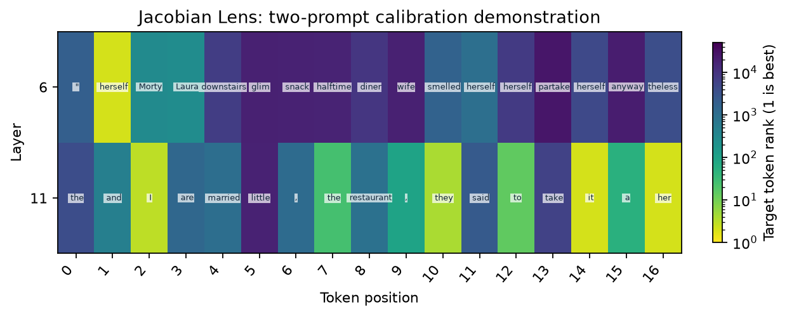

# Jacobian Lens

[Home](../../README.md) / [Methods](README.md) / Jacobian Lens

Estimate a mean downstream residual Jacobian, transport a representation, and decode the transported vector.

## API and parameters

`probe` is a `Prober` bound to a loaded model; `inputs` contains prepared model inputs. The blocks below are API signatures: `*` marks keyword-only parameters, not an argument to copy. The [complete example](#complete-live-example) defines the model, inputs, and all other variables before running the method.

```text
method = probe.lens.jacobian(*, layers=None, tokens="all", binding=None)
method.fit(inputs, *, skip_first=16, exclude_last=True,
           target_mask=None, max_sources=None, seed=0)
result = method.run(inputs)
method.save(directory)
method.load(directory)
```

| Parameter | Default | Meaning and constraints |
| --- | --- | --- |
| `layers` | `None` | Source residual layers; a separate matrix is estimated per layer. |
| `tokens` | `"all"` | Source positions intersected with valid positions and exclusions. |
| `binding` | `None` | Explicit checkpoint/tokenizer/readout/calibration identities for saving/loading. |
| `skip_first` | `16` | Nonnegative count of initial valid positions excluded per prompt. Set to `0` for short prompts. |
| `exclude_last` | `True` | Exclude each prompt's final valid position from retained sources/targets. |
| `target_mask` | `None` | Optional boolean `[B,T]` target positions; defaults to valid retained positions. |
| `max_sources` | `None` | Optional positive maximum sampled source positions per prompt. Does not reduce output-dimension backward passes. |
| `seed` | `0` | RNG seed for source-position subsampling. |
| `inputs` | Required | Prepared calibration/evaluation input. Every calibration prompt must retain a source and a target. |

Returns `transported[L,N,D_final]`, `logits[L,N,V]` and `positions[N,2]`.
`J[out,in]` sums final-residual cotangents at retained targets, averages source
positions within a prompt and then averages prompts. Evaluation applies `J @ h`
without an intercept. Fitting estimates derivatives; it does not optimize a
classifier. Repeated one-batch `fit` replaces the estimate and emits a
`RuntimeWarning` before calibration; it does not accumulate batches. Use
[`fit_jacobian_lenses`](#dataset-estimator) below for dataset calibration.

### Calibration position requirements

With `skip_first=16` and `exclude_last=True`, each prompt needs at least **18 valid
expanded token positions**, including image tokens where present. Padded width
does not count. This minimum assumes unrestricted selectors: selected sources
and targets must also survive the exclusions. In particular,
`tokens="last_prompt"` with the default all-prompt layout selects the final valid
token, which `exclude_last=True` removes even for a long prompt.

Calibration rejects the whole batch before computing derivatives if any row
has no retained source or target. The error lists the failing zero-based rows,
valid-token counts, retained source/target counts, exclusion settings and source
selector. It never silently drops short rows. Use longer calibration contexts,
or deliberately choose `skip_first=0, exclude_last=False` for a short-context
study and record that different calibration convention. An empty or disjoint
source/target mask must still be corrected independently of prompt length.

### Dataset estimator

```text
from vlmprobe.training import fit_jacobian_lenses
method, report = fit_jacobian_lenses(
    probe, input_batches, *, layers, binding, directory,
    dim_batch=32, skip_first=16, exclude_last=True, tokens="text",
    resume=True, checkpoint_every=16, snapshot_counts=(64, 128, 256),
)
```

| Parameter | Default | Meaning and constraints |
| --- | --- | --- |
| `probe` / `input_batches` | Required | Bound Prober / deterministic re-iterable independent calibration batches. |
| `layers` / `binding` / `directory` | Required | Selected layers / explicit artifact identities / output directory. |
| `dim_batch` | `32` | Positive exact basis-vector VJPs grouped per backward call; total derivatives still scale with hidden width. |
| `skip_first` / `exclude_last` | `16` / `True` | Position exclusions above. |
| `tokens` | `"text"` | Source-position selector. |
| `resume` | `True` | Resume matching accumulated prompt-weighted Jacobians. |
| `checkpoint_every` | `16` | Save resumable state every this many input batches. |
| `snapshot_counts` | `(64,128,256)` | Save prefix estimates when a processed prompt count exactly reaches one of these values. |

The estimator applies the same position checks to every batch and identifies the
batch index in errors. It sums per-prompt Jacobians and divides by the total
number of prompts, so a short final batch has the correct weight. Calling
`method.fit_batches(...)` is reserved for Tuned/Attention Lens and points to
`vlmprobe.training.fit_jacobian_lenses(...)` when used for Jacobian Lens.

Do not fit under `torch.inference_mode()`. Exact calibration scales with hidden
width and can be expensive even for one source layer. The example deliberately
uses only two calibration prompts; it demonstrates execution, not convergence.


## Input and coordinate conventions

`inputs` is a native model-input dictionary or `ProbeInputs` from `probe.prepare(...)`.
All examples below are complete scripts; they do not depend on variables from a
model guide. Install `pip install "vlmprobe[transformers,visualization]"` first.
`VLM_PROBING_MODEL` may select a compatible local checkpoint; public defaults use
Hugging Face model IDs. For a VLM, replace only model/processor loading and input
preparation with its [model guide](../models/README.md); the method call and result
contract remain the same wherever `probe.describe()` reports support.

Layer indices are zero-based blocks, measured **after** each block. `None` selects
all available layers; an integer or nonempty list of unique available integers
selects a subset. Shared `tokens` selectors are `"last_prompt"`, `"all"`, `"visual"`,
`"text"`, `"prediction"`, a single expanded position, a sequence of positions, or a boolean
`[batch, expanded_sequence]` mask. `"prediction"` selects the final prompt position and subsequent teacher-forced/generated positions when an explicit prompt mask is supplied. String selectors exclude padding; explicit positions/masks must not select padding. Packed outputs carry
`positions[N,2] = [batch index, expanded token index]`; `N` is not the original
unpadded text length when images add tokens.

## Complete live example

```python
import hashlib
import json
import os
from pathlib import Path

import matplotlib.pyplot as plt
import torch
from transformers import AutoTokenizer, GPT2LMHeadModel
from vlmprobe import Prober
from vlmprobe.visualization import plot_lens_heatmap

# A pretrained text model, not a random architecture or cached probe result.
MODEL_ID = os.environ.get("VLM_PROBING_MODEL", "openai-community/gpt2")
DEVICE = os.environ.get("VLM_PROBING_DEVICE", "cuda:0" if torch.cuda.is_available() else "cpu")
OUT = Path(os.environ.get("VLM_PROBING_OUTPUT", "outputs/lens_tutorial"))
OUT.mkdir(parents=True, exist_ok=True)
torch.manual_seed(0)
model = GPT2LMHeadModel.from_pretrained(MODEL_ID, attn_implementation="eager").to(DEVICE).eval()
tokenizer = AutoTokenizer.from_pretrained(MODEL_ID)
probe = Prober(model, tokenizer)
print(probe.describe())

def prepare(text):
    return probe.prepare(prompt=text, device=DEVICE)

prompt = "When Amy and Laura got a snack at the house, Laura decided to give it to"
inputs = prepare(prompt)
answer_ids = tokenizer.encode(" Amy", add_special_tokens=False)
assert len(answer_ids) == 1, "Choose a single target subword for this rank plot."
answer_id = answer_ids[0]
# Disjoint strings illustrate the protocol; this tiny split is not a quality benchmark.
train_texts = [
    "The child opened a book and began to read.",
    "A red boat crossed the lake before sunset.",
    "The baker placed fresh bread beside the window.",
    "Two friends walked through a quiet garden.",
]
validation_texts = [
    "A musician carried a violin onto the stage.",
    "The train arrived at the station after midnight.",
]
assert not (set(train_texts) & set(validation_texts))
assert prompt not in train_texts + validation_texts
train_inputs = [prepare(text) for text in train_texts]
validation_inputs = [prepare(text) for text in validation_texts]
split_hash = hashlib.sha256(json.dumps([train_texts, validation_texts]).encode()).hexdigest()
binding = {
    "model_id": MODEL_ID + "@" + str(getattr(model.config, "_commit_hash", None) or "local-checkpoint"),
    "tokenizer_id": tokenizer.name_or_path,
    "readout_id": "transformer.ln_f+lm_head",
    "calibration_id": "tutorial-distinct-texts-sha256:" + split_hash,
}
# For a release, pin the model/tokenizer revision and hash the local checkpoint
# if config._commit_hash is unavailable. This binding is caller-declared identity.
from vlmprobe.training import fit_jacobian_lenses

layers = [model.config.n_layer // 2, model.config.n_layer - 1]
# Exact VJPs still scale with hidden width: dim_batch changes grouping, not accuracy.
lens, calibration = fit_jacobian_lenses(
    probe, train_inputs[:2], layers=layers, binding=binding,
    directory=OUT / "jacobian-artifact", dim_batch=32,
    skip_first=0, exclude_last=False, tokens="text", resume=False,
)
result = lens.run(inputs)
print("calibrated prompts:", calibration["prompts"])
print("transported / logits:", result.tensors["transported"].shape, result.tensors["logits"].shape)
ax = plot_lens_heatmap(result, target_token_id=answer_id, tokenizer=tokenizer,
                       title="Jacobian Lens: two-prompt calibration demonstration")
ax.figure.savefig(OUT / "jacobian.png", dpi=160, bbox_inches="tight")
plt.show()
restored = probe.lens.jacobian(layers=layers, tokens="text", binding=binding).load(OUT / "jacobian-artifact")
```

Run the same code as a script: [lens_jacobian.py](../../examples/tutorials/lens_jacobian.py).

## Output and visualization

Rows are source residual layers and columns are original prompt positions. The map reports vocabulary ranks after a fixed linear transport; it is not a gradient saliency map or an effect of ablating the token. Generalization requires a larger independent calibration corpus.



The preview is generated by the live tutorial, not a loaded measurement snapshot.
[Checkpoint hashes, data split and run provenance](../assets/tutorials/lens-provenance.json).
[Source/reference](../REFERENCES.md#lens-methods) · [Training and artifact protocol](../TRAINING.md).
