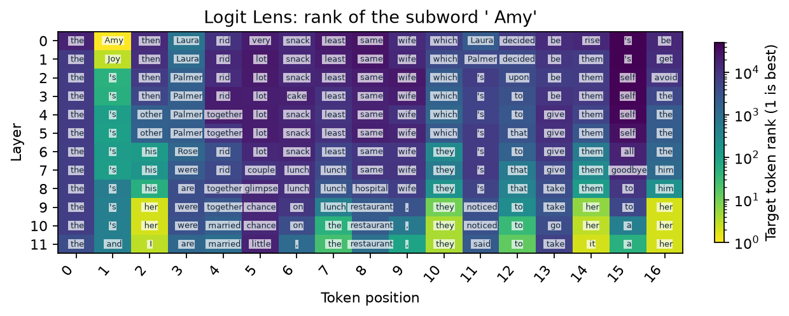

# Logit Lens

[Home](../../README.md) / [Methods](README.md) / Logit Lens

Read each intermediate residual through the model's native final normalization and vocabulary head.

## API and parameters

`probe` is a `Prober` bound to a loaded model; `inputs` contains prepared model inputs. The blocks below are API signatures: `*` marks keyword-only parameters, not an argument to copy. The [complete example](#complete-live-example) defines the model, inputs, and all other variables before running the method.

```text
method = probe.lens.logit(*, layers=None, tokens="last_prompt")
result = method.run(inputs)
```

| Parameter | Default | Meaning and constraints |
| --- | --- | --- |
| `layers` | `None` | Residual block selection; see shared coordinate conventions below. |
| `tokens` | `"last_prompt"` | Positions to decode; use `"text"` for all valid text positions. |
| `inputs` | Required | Prepared model inputs; no labels or training required. |

Returns `logits[L,N,V]` and `positions[N,2]` in a `ProbeResult`. The readout is
`lm_head(final_norm(h_layer))`; it is not softmax unless you request probabilities
in the plot. The final residual readout should equal the model's native logits
apart from floating-point effects. No hyperparameter fitting is involved.


## Input and coordinate conventions

`inputs` is a native model-input dictionary or `ProbeInputs` from `probe.prepare(...)`.
All examples below are complete scripts; they do not depend on variables from a
model guide. Install `pip install "vlmprobe[transformers,visualization]"` first.
`VLM_PROBING_MODEL` may select a compatible local checkpoint; public defaults use
Hugging Face model IDs. For a VLM, replace only model/processor loading and input
preparation with its [model guide](../models/README.md); the method call and result
contract remain the same wherever `probe.describe()` reports support.

Layer indices are zero-based blocks, measured **after** each block. `None` selects
all available layers; an integer or nonempty list of unique available integers
selects a subset. Shared `tokens` selectors are `"last_prompt"`, `"all"`, `"visual"`,
`"text"`, `"prediction"`, a single expanded position, a sequence of positions, or a boolean
`[batch, expanded_sequence]` mask. `"prediction"` selects the final prompt position and subsequent teacher-forced/generated positions when an explicit prompt mask is supplied. String selectors exclude padding; explicit positions/masks must not select padding. Packed outputs carry
`positions[N,2] = [batch index, expanded token index]`; `N` is not the original
unpadded text length when images add tokens.

## Complete live example

```python
import os
from pathlib import Path

import matplotlib.pyplot as plt
import torch
from transformers import AutoTokenizer, GPT2LMHeadModel
from vlmprobe import Prober
from vlmprobe.visualization import plot_lens_heatmap

# A pretrained text model, not a random architecture or cached probe result.
MODEL_ID = os.environ.get("VLM_PROBING_MODEL", "openai-community/gpt2")
DEVICE = os.environ.get("VLM_PROBING_DEVICE", "cuda:0" if torch.cuda.is_available() else "cpu")
OUT = Path(os.environ.get("VLM_PROBING_OUTPUT", "outputs/lens_tutorial"))
OUT.mkdir(parents=True, exist_ok=True)
torch.manual_seed(0)
model = GPT2LMHeadModel.from_pretrained(MODEL_ID, attn_implementation="eager").to(DEVICE).eval()
tokenizer = AutoTokenizer.from_pretrained(MODEL_ID)
probe = Prober(model, tokenizer)
print(probe.describe())

def prepare(text):
    return probe.prepare(prompt=text, device=DEVICE)

prompt = "When Amy and Laura got a snack at the house, Laura decided to give it to"
inputs = prepare(prompt)
answer_ids = tokenizer.encode(" Amy", add_special_tokens=False)
assert len(answer_ids) == 1, "Choose a single target subword for this rank plot."
answer_id = answer_ids[0]
layers = sorted(probe.describe()["methods"]["lens.logit"]["sites"])
result = probe.lens.logit(layers=layers, tokens="text").run(inputs)
print("logits [layers, packed positions, vocabulary]:", result.tensors["logits"].shape)
print("[batch, expanded-token position]:", result.tensors["positions"])
result.save(OUT / "logit-result")
ax = plot_lens_heatmap(result, target_token_id=answer_id, tokenizer=tokenizer,
                       title="Logit Lens: rank of the subword ' Amy'")
ax.figure.savefig(OUT / "logit.png", dpi=160, bbox_inches="tight")
plt.show()
```

Run the same code as a script: [lens_logit.py](../../examples/tutorials/lens_logit.py).

## Output and visualization

Color is the rank of one fixed target subword at each prediction position; smaller is better. Cell annotations are exact tokenizer-decoded top-1 subwords and may be multilingual or incomplete. They are not generated sentences or causal evidence.



The preview is generated by the live tutorial, not a loaded measurement snapshot.
[Checkpoint hashes, data split and run provenance](../assets/tutorials/lens-provenance.json).
[Source/reference](../REFERENCES.md#lens-methods) · [Training and artifact protocol](../TRAINING.md).
