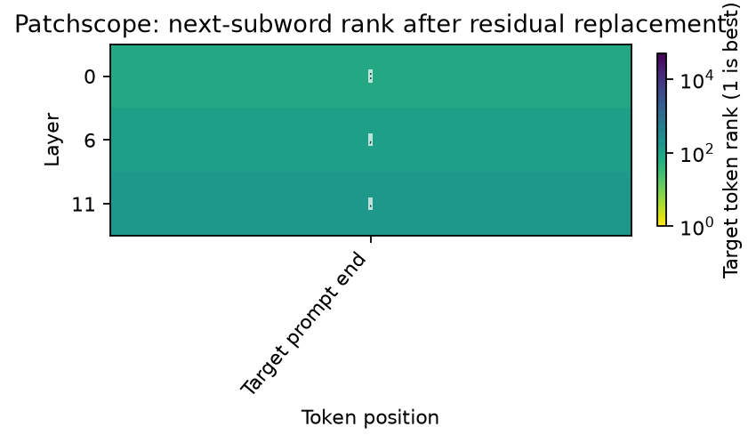

# Patchscope

[Home](../../README.md) / [Methods](README.md) / Patchscope

Replace one target-prompt residual with a source representation and inspect the target next-token readout.

## API and parameters

`probe` is a `Prober` bound to a loaded model; `inputs` contains prepared model inputs. The blocks below are API signatures: `*` marks keyword-only parameters, not an argument to copy. The [complete example](#complete-live-example) defines the model, inputs, and all other variables before running the method.

```text
method = probe.lens.patchscope(*, layers, source_position, target_layer,
                     target_position, target=None, mapping=None)
result = method.run(inputs, *, target_inputs)
```

| Parameter | Default | Meaning and constraints |
| --- | --- | --- |
| `layers` | Required | Source residual layer integer/list; each layer is patched in an independent forward pass. |
| `source_position` | Required | One expanded source-token position valid in every batch item. |
| `target_layer` | Required | Destination residual layer in the target Prober. |
| `target_position` | Required | One expanded target-token position valid in every batch item. |
| `target` | `None` | Destination Prober; defaults to the source Prober. |
| `mapping` | `None` | Callable mapping source `[B,D_source]` vectors to target `[B,D_target]`. Required for different model instances; width alone does not establish semantic alignment. |
| `inputs` | Required | Source native inputs or `ProbeInputs`. |
| `target_inputs` | Required | Target native inputs or `ProbeInputs`; source and target batch sizes must match. |

Returns teacher-forced target `logits[L,B,T_target,V]` plus source/target
provenance. There is no `positions` packing because the complete target sequence
is returned. The method does not perform autoregressive generation. An identity
mapping in the same model needs no calibration; a cross-model mapping must be
provided and trained/validated separately by the caller.


## Input and coordinate conventions

`inputs` is a native model-input dictionary or `ProbeInputs` from `probe.prepare(...)`.
All examples below are complete scripts; they do not depend on variables from a
model guide. Install `pip install "vlmprobe[transformers,visualization]"` first.
`VLM_PROBING_MODEL` may select a compatible local checkpoint; public defaults use
Hugging Face model IDs. For a VLM, replace only model/processor loading and input
preparation with its [model guide](../models/README.md); the method call and result
contract remain the same wherever `probe.describe()` reports support.

Layers are zero-based residual blocks measured after each block. Supply the
source layers explicitly. `source_position` and `target_position` are single
expanded-sequence positions, valid in every item of their respective batch;
there is no `tokens` selector. Source and target prompts may have different
lengths. Outputs retain the complete target sequence rather than packed rows.

## Complete live example

```python
import os
from pathlib import Path

import matplotlib.pyplot as plt
import torch
from transformers import AutoTokenizer, GPT2LMHeadModel
from vlmprobe import Prober
from vlmprobe.visualization import plot_lens_heatmap

# A pretrained text model, not a random architecture or cached probe result.
MODEL_ID = os.environ.get("VLM_PROBING_MODEL", "openai-community/gpt2")
DEVICE = os.environ.get("VLM_PROBING_DEVICE", "cuda:0" if torch.cuda.is_available() else "cpu")
OUT = Path(os.environ.get("VLM_PROBING_OUTPUT", "outputs/lens_tutorial"))
OUT.mkdir(parents=True, exist_ok=True)
torch.manual_seed(0)
model = GPT2LMHeadModel.from_pretrained(MODEL_ID, attn_implementation="eager").to(DEVICE).eval()
tokenizer = AutoTokenizer.from_pretrained(MODEL_ID)
probe = Prober(model, tokenizer)
print(probe.describe())

def prepare(text):
    return probe.prepare(prompt=text, device=DEVICE)

source_text = "The capital of France is Paris"
target_text = "Apple: Apple\nOrange: Orange\nBanana:"
source_inputs, target_inputs = prepare(source_text), prepare(target_text)
source_position = source_inputs.kwargs["input_ids"].shape[1] - 1
target_position = target_inputs.kwargs["input_ids"].shape[1] - 1
layers = [0, model.config.n_layer // 2, model.config.n_layer - 1]
scope = probe.lens.patchscope(layers=layers, source_position=source_position,
                              target_layer=0, target_position=target_position)
result = scope.run(source_inputs, target_inputs=target_inputs)
print("teacher-forced logits [source layer, batch, target position, vocabulary]:", result.tensors["logits"].shape)
# Last target-position logits measure one next-token readout, not generated text.
paris_ids = tokenizer.encode(" Paris", add_special_tokens=False)
assert len(paris_ids) == 1
logits = result.tensors["logits"][:, 0, -1:, :]
for layer, row in zip(layers, logits[:, 0]):
    print(layer, "top next subword:", repr(tokenizer.decode([int(row.argmax())])))
ax = plot_lens_heatmap(logits, target_token_id=paris_ids[0], layer_labels=layers,
                       token_labels=["Target prompt end"], tokenizer=tokenizer,
                       title="Patchscope: next-subword rank after residual replacement")
ax.figure.savefig(OUT / "patchscope.png", dpi=160, bbox_inches="tight")
plt.show()
```

Run the same code as a script: [lens_patchscope.py](../../examples/tutorials/lens_patchscope.py).

## Output and visualization

Rows identify the source layer patched into the fixed target prompt. The single column shows the final target prediction position. A changed next-subword rank demonstrates the performed replacement; it is not a faithful natural-language explanation of the source state.



The preview is generated by the live tutorial, not a loaded measurement snapshot.
[Checkpoint hashes, data split and run provenance](../assets/tutorials/lens-provenance.json).
[Source/reference](../REFERENCES.md#lens-methods) · [Training and artifact protocol](../TRAINING.md).
