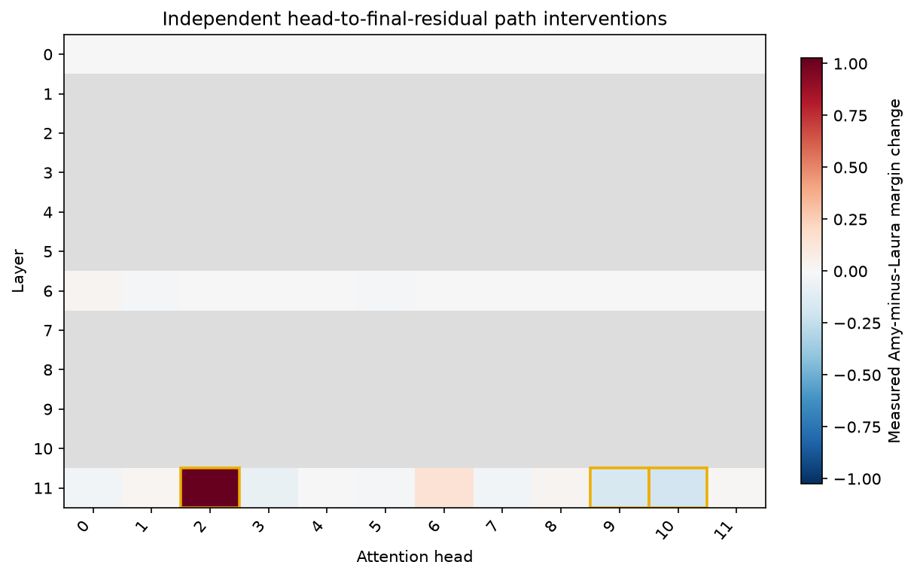

# IOI Path Patching

[Home](../../README.md) / [Methods](README.md) / IOI Path Patching

Test whether changing a sender attention-head output affects an answer through a specified receiver Q/K/V input or final residual. This API performs actual controlled forwards.

## API and parameters

`probe` is a `Prober` bound to a loaded model; `inputs` contains prepared model inputs. The blocks below are API signatures: `*` marks keyword-only parameters, not an argument to copy. The [complete example](#complete-example-input-to-output) defines the model, inputs, and all other variables before running the method.

```text
method = probe.causal.path(
    *, senders, receivers="residual", sender_tokens="last_prompt",
    donor_tokens=None, receiver_tokens="last_prompt",
)
result = method.run(inputs, *, donor, metric, alignment="strict")
sweep = method.sweep(inputs, *, donor, metric, alignment="strict", progress=None)
```

| Parameter | Default | Meaning and constraints |
| --- | --- | --- |
| `senders` | required | Nonempty list of unique `(layer, head)` pairs. Sender heads use physical query-head IDs, zero based. |
| `receivers` | `"residual"` | Final residual before final normalization, or nonempty list of `(layer, head, kind)` triples with `kind` equal to `"q"`, `"k"`, or `"v"`. |
| `sender_tokens` | `"last_prompt"` | Base positions where donor sender-head outputs are inserted. |
| `donor_tokens` | `None` | Defaults to `sender_tokens`; explicitly select donor positions for a custom role mapping. Each example must select the same positive count of base/donor positions; they pair in ascending position order. |
| `receiver_tokens` | `"last_prompt"` | Base positions whose controlled receiver values are inserted into the final fresh base run. |
| `inputs / donor` | required | Native base/donor kwargs or `ProbeInputs`, with structurally aligned expanded layouts. |
| `metric` | required | Scalar or per-example output score; see metric contract below. |
| `alignment` | `"strict"` | Choose `"position"` only after verifying semantic role alignment when token IDs differ. Structural masks/metadata must still match. |
| `progress` | `None` (`sweep` only) | Optional callable `(completed, total, sender)` after each measured path. It receives a one-based completion count. |

Selections use zero-based **expanded model coordinates**, including image tokens. Common token selectors are `"all"`, `"visual"`, `"text"`, `"last_prompt"`, `"prediction"`, an integer/list of positions, or a boolean `[B,T]` mask. `"last_prompt"` selects one final context token; `"prediction"` additionally selects generated positions when `TokenLayout.prompt` preserves the original context. `"visual"`/`"text"` need a visual-token layout. For text-only examples, explicitly choose `tokens="all"` or `"last_prompt"` rather than the visual-token default.

A metric is a `TokenMargin`, `SequenceLogProb`, or a callable `metric(logits)` returning a scalar or `[B]`; it is evaluated on full-sequence logits. `TokenMargin(positive, negative, position="last_prompt")` compares two vocabulary IDs at one selected prediction position. For multi-token answers, explicitly append answer tokens, preserve the original prompt boundary, and use `SequenceLogProb(answer_mask, reduction="sum")` or `"mean"`. First-subword margins are not complete-answer probabilities.

### The four forward stages

1. Cache unmodified base head outputs and receiver activations.
2. Cache donor sender-head outputs.
3. Run the base with donor sender values, while every other head output remains frozen at its cached base value. MLPs and LayerNorms recompute. Cache the requested receiver values from this controlled run.
4. Run a fresh base with only those controlled receiver values inserted; sender replacement and head-freezing controls are removed.

`.run()` changes the configured sender set jointly in four forwards. `.sweep()` tests each sender independently, reusing base/donor caches, for `2 + 2N` forwards. The receiver set is fixed across the sweep.

`.run()` returns scalar or `[B]` `baseline_score`, `donor_score`, `intervention_score`, and `effect` matching the metric. `.sweep()` keeps baseline/donor shapes and returns `effect[N,B]` (or `[N]` for a scalar metric), with `senders[N,2]` recording actual coordinates. The effect is intervention minus base. No layer-sweep dimension is added to `.run()`.

Install `pip install "vlmprobe[transformers,visualization]"`. The following block is complete: it loads GPT-2, constructs an author-published IOI prompt pair, checks candidate tokenization, runs the methods, saves results, and draws the built-in plots. First use downloads GPT-2 (about 0.5 GB); CPU works and CUDA is faster. No method training is needed. `VLM_PROBING_MODEL` can point to an existing local checkpoint.

## Complete example: input to output

```python
import os
from pathlib import Path
import torch
import matplotlib.pyplot as plt
from transformers import AutoTokenizer, GPT2LMHeadModel
from vlmprobe import Prober, TokenMargin
from vlmprobe.visualization import plot_causal_heatmap, plot_intervention_curves

# First run downloads GPT-2 (~0.5 GB). Use an existing local checkpoint if desired.
model_id = os.environ.get("VLM_PROBING_MODEL", "openai-community/gpt2")
device = os.environ.get("VLM_PROBING_DEVICE", "cuda:0" if torch.cuda.is_available() else "cpu")
model = GPT2LMHeadModel.from_pretrained(model_id, attn_implementation="eager").to(device).eval()
tokenizer = AutoTokenizer.from_pretrained(model_id)
probe = Prober(model, processor=tokenizer)
print({name: info for name, info in probe.describe()["methods"].items()
       if name.startswith("causal.")})
output_dir = Path(os.environ.get("VLM_PROBING_OUTPUT", "outputs/tutorials/causal"))
output_dir.mkdir(parents=True, exist_ok=True)
# An explicit author-published IOI pair (row 826); no result snapshots are used.
# Source: hannamw/eap-ig-faithfulness, data/ioi/gpt2.csv; see docs/REFERENCES.md.
clean_prompt = "When Amy and Laura got a snack at the house, Laura decided to give it to"
reference_prompt = "When Amy and Laura got a snack at the house, Nicholas decided to give it to"

def prepare_text(text):
    # The authors prepend GPT-2's BOS token. Keep the convention explicit.
    ids = [tokenizer.bos_token_id, *tokenizer.encode(text, add_special_tokens=False)]
    input_ids = torch.tensor([ids], device=device)
    return {"input_ids": input_ids, "attention_mask": torch.ones_like(input_ids)}

inputs = prepare_text(clean_prompt)
reference = prepare_text(reference_prompt)
assert inputs["input_ids"].shape == reference["input_ids"].shape, "Pair token lengths must match"
positive_ids = tokenizer.encode(" Amy", add_special_tokens=False)
negative_ids = tokenizer.encode(" Laura", add_special_tokens=False)
assert len(positive_ids) == len(negative_ids) == 1, "TokenMargin requires one-token candidates"
metric = TokenMargin(positive=positive_ids[0], negative=negative_ids[0])
print("Clean:", clean_prompt)
print("Reference:", reference_prompt)
print("Candidates:", tokenizer.decode(positive_ids), tokenizer.decode(negative_ids))
# Check the role alignment, not just the equal length.
for position, (a, b) in enumerate(zip(inputs["input_ids"][0], reference["input_ids"][0])):
    print(position, repr(tokenizer.decode([a.item()])), repr(tokenizer.decode([b.item()])))
# A short scan: all heads in the first, middle, and last decoder layer.
# Other layers are genuinely unmeasured and remain gray in the plot.
available = sorted(probe.spec.path_heads)
selected_layers = sorted({available[0], available[len(available) // 2], available[-1]})
senders = [(layer, head) for layer in selected_layers
           for head in range(probe.spec.path_heads[layer].heads)]
method = probe.causal.path(
    senders=senders, receivers="residual", sender_tokens="last_prompt",
    donor_tokens="last_prompt", receiver_tokens="last_prompt",
)
result = method.sweep(inputs, donor=reference, metric=metric, alignment="position")
print("Baseline margin:", result.tensors["baseline_score"])
print("Reference margin:", result.tensors["donor_score"])
print("Measured effects [sender,batch]:", result.tensors["effect"].shape)
print("Actual forward passes:", result.metadata["actual_forward_passes"])
result.save(output_dir / "path_patching")
# A no-change control executes the same four-stage intervention with identical inputs.
identity = probe.causal.path(senders=[senders[0]], receivers="residual").run(
    inputs, donor=inputs, metric=metric,
)
print("Identity-donor effect (should be near zero):", identity.tensors["effect"])
ax = plot_causal_heatmap(
    result, layer_labels=available,
    column_labels=list(range(model.config.n_head)),
    title="Independent head-to-final-residual path interventions",
    value_label="Measured Amy-minus-Laura margin change", highlight_count=3,
)
ax.figure.set_size_inches(8, 5)
ax.figure.savefig(output_dir / "causal-path-patching.png", dpi=150, bbox_inches="tight")
plt.show()
```
### Model contract and additional receivers

Check `probe.describe()["methods"]["causal.path"]`. Complete editable head-output coverage at every decoder layer is required to enforce freezing, together with selected Q/K/V receiver sites or the final residual. Qwen3.5's mixed linear/full-attention decoder currently fails that complete-coverage contract; logit lens support does not imply path support.

Native adapters freeze the value aggregation at the attention output-projection input. The fixed linear output projection then preserves each head's residual contribution, with its shared bias applied once. Q/K/V receivers are captured before positional rotation; Qwen3-VL uses normalized Q/K before rotation. Later positional operations recompute at base coordinates.

For grouped-query attention, sender and Q indices are query heads, while K/V indices are **physical KV heads**. One shared KV head affects its whole query group. To move visual information toward a text prediction under head-output freezing, capture K/V at visual positions; freezing all head outputs prevents fresh cross-position attention propagation in the controlled stage. For Q receivers, sender and receiver positions generally need to overlap.

The adopted control rule is explicit head-output freezing with live MLP/LayerNorm computation. Alternate author-code Q/K/V-freezing or frozen-MLP settings are not silently mixed in. A nonzero route effect does not establish a human-readable functional head role. Identity donors and unreachable paths should be near zero within numerical precision.

A complete native V-receiver extension is included at the end of the [live notebook](../../demos/path_patching_demo.ipynb). [Standalone script](../../examples/tutorials/causal_path_patching.py) · [Reference](../REFERENCES.md#causal-methods) · [Implementation](../../src/vlm_probing/causal/path_patching.py)

## Example visualization

This preview was generated by running the code on **pretrained GPT-2** with the explicit IOI pair below. It is an example-level result, not a full-dataset reproduction. The notebook reruns inference and does not load the preview.


