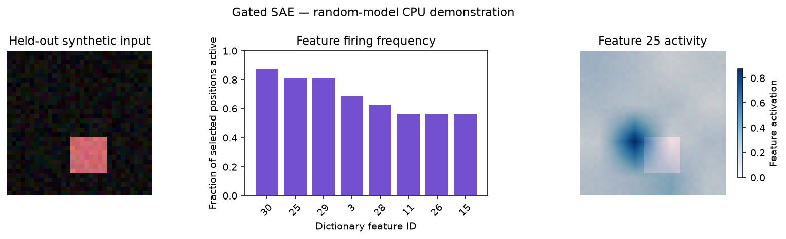

# Gated SAE

[Home](../../../README.md) / [Methods](../README.md) / [SAE](README.md) / Gated SAE

Separate the decision to activate a feature from its predicted magnitude.

## Principle

Here $u$ is the declared normalized backbone activation, $D$ is the decoder
dictionary, and $b_d$ is its bias. With the default scalar recipe, normalization
is fitted on training activations and decoded values are returned in raw units.

The gate logits are $a=W_e(u-b_d)+b_g$. A separate magnitude path
uses $m=\operatorname{ReLU}(\operatorname{diag}(\exp(r))W_e(u-b_d)+b_m)$,
and $z_i=\mathbb 1[a_i>0]m_i$. The objective adds reconstruction error, L1 on
`relu(a)`, and an auxiliary reconstruction through the rectified gate. The
auxiliary decoder and its centering/output biases are detached; its gradients
train the gate without moving the dictionary. This separates gate sparsity from
main-path magnitudes, although learned directions still require interpretation.

**Analysis question:** Which patches pass each learned feature gate, with magnitudes estimated independently of that gate?

## API and parameters

**Call signatures.** These describe the arguments, including keyword-only
parameters marked by `*`; they are API notation rather than a standalone
Python script. The factory returns `method`, and `.fit(...)` returns `history`.

```text
method = probe.sae.gated(*, layer, tokens="all", d_sae=None, expansion_factor=4, **parameters)
history = method.fit(train_inputs, validation_inputs, *, output_dir, training=None,
           train_ids=None, validation_ids=None, preprocessing_id="caller-prepared:unverified",
           max_cache_bytes=1073741824, provenance=None)
result = method.run(inputs)
```

**Usage sequence.** The [complete live example](#complete-live-example)
constructs `probe`, `train_inputs`, `validation_inputs`, and `test_inputs`.
With those inputs, create the method before fitting or running it:

```python
from vlmprobe.sae import SAETrainingConfig

method = probe.sae.gated(
    layer=0, tokens="visual", d_sae=32,
    l1_coefficient=0.02,
)
history = method.fit(
    train_inputs, validation_inputs,
    output_dir="outputs/sae_gated/api_training",
    training=SAETrainingConfig(max_steps=24, batch_size=16, lr=0.003, seed=7),
)
result = method.run(test_inputs)
```

The factory configures this algorithm; it does not train or download a dictionary.
Call `.fit(...)` to train the SAE on frozen-model activations. To analyze with
an existing dictionary, skip fitting and follow [pretrained loading](loading.md):
`probe.sae.load("my_dictionary").run(inputs)` loads a compatible native artifact;
supported published checkpoints use `probe.sae.from_pretrained(...)`.

| Parameter | Default | Meaning and constraints |
| --- | --- | --- |
| `layer` | Required | One zero-based residual block, measured after that block; inspect `probe.describe()` for available layers. |
| `tokens` | `"all"` | Positions to encode: `"visual"`, `"text"`, `"last_prompt"`, explicit expanded positions, or a `[batch, expanded_sequence]` boolean mask. String selectors exclude padding. |
| `d_sae` | `None` | Positive dictionary width; omitted means `d_in * expansion_factor`. The captured native activation width supplies `d_in`. |
| `expansion_factor` | `4` | Positive integer width multiplier used only when `d_sae` is omitted. |
| `seed` | `0` | Dictionary initialization seed; independent of the backbone's initialization seed and the trainer's permutation seed. |
| `input_normalization` | `"scalar"` | Train-fitted scalar RMS by default; also `"none"`, `"layer_norm"`, or `"constant_norm"`. Decoder outputs return to raw activation coordinates. |
| `normalization` | `None` | Optional recipe alias: `"rms"`, `"none"`, `"layer_norm"`, or `"constant_norm_rescale"`; overrides `input_normalization`. |
| `apply_decoder_bias_to_input` | `True` | Center normalized inputs by decoder bias before encoding; `apply_b_dec_to_input` is a supported alias. |
| `use_decoder_bias` | `True` | Include the decoder's output bias. |
| `normalization_eps` | `1e-5` | Positive constant added to the per-vector standard deviation in `layer_norm`; scalar/constant-norm recipes do not add it. |
| `normalization_std_correction` | `0` | Layer-normalization standard deviation uses population (`0`) or sample (`1`) correction. |
| `rescale_acts_by_decoder_norm` | `False` | Source-compatible recipe using unit decoder directions; TopK also rescales ranked coefficients by the original atom norms. Leave disabled for the native examples. |
| `normalize_decoder` | `True` | Project learned decoder columns to unit L2 norm after updates. Archetypal recipes instead enforce their stated relaxation bound. |

### Method-specific controls

| Parameter | Default | Meaning and constraints |
| --- | --- | --- |
| `l1_coefficient` | `0.01` | Nonnegative L1 coefficient on rectified gate logits, not on main-path magnitude values. |

All mathematical options are recorded in `method.sae.config` after fitting.
Unknown keyword arguments raise an error. The [API reference](API.md) includes
less common normalization/import compatibility flags. See [model cards and model
selection](models/README.md) for pretrained and user-trained dictionaries.

### Fitting and inference

| Fit/run parameter | Default | Meaning |
| --- | --- | --- |
| `train_inputs`, `validation_inputs` | Required | Finite independent sequences of native model-input batches or `ProbeInputs`; these are images/text, not precomputed probe results. |
| `output_dir` | Required | Training checkpoints, history and portable inference artifact directory. Reusing a compatible directory resumes when enabled. |
| `training` | `SAETrainingConfig()` | Shared protocol: `epochs=10`, `batch_size=256` activation vectors, `lr=1e-3`, `patience=3`, `min_delta=1e-4`, `normalization="rms"`, `seed=0`, `device="cpu"`, `resume=True`, `grad_clip=5.0`, `progress_every=20`. `max_steps=None` or `max_vectors=None` can replace the epoch ceiling; they cannot be combined. |
| `train_ids`, `validation_ids` | `None` | Source image/document/patient group IDs. Supply them to check independence before flattening token positions. |
| `preprocessing_id` | `"caller-prepared:unverified"` | Identify the exact resize/crop/tokenization/normalization used to make inputs; set it explicitly for reusable artifacts. |
| `max_cache_bytes` | `1073741824` | Per-split activation-payload bound for the finite CPU cache; concatenation and other split memory are additional. |
| `provenance` | `None` | Optional JSON experiment/data identifiers retained with training. |
| `inputs` in `.run(inputs)` | Required | Fresh native model inputs with the fitted model, hook and preprocessing. |

The backbone remains frozen; only the dictionary is trained. Validation selects
an inference artifact, while `training_state.pt` retains optimizer/RNG state for
continuation. See the [training protocol](training/README.md) for objectives,
normalization, source independence, early stopping and resume constraints.

## Complete live example

Install `python -m pip install "vlmprobe[sae,transformers,visualization] @ git+https://github.com/gexinh/vlm-prob.git@main"`.
This complete script downloads no weights or dataset: it creates a small random
ViT and independent synthetic images, captures real residuals, trains the
selected algorithm, evaluates a held-out image and calls the library's plotting
functions. Run it from a directory where you can write `outputs/`.
Replace the random model and synthetic data with a frozen trained backbone and
independent image/document groups for a scientific experiment; the method calls
remain the same. [Backbone input guides](../../models/README.md).

<!-- runnable-example -->
```python
import os
from pathlib import Path

import matplotlib.pyplot as plt
import torch
from transformers import ViTConfig, ViTForImageClassification
from vlmprobe import Prober, visualization as viz
from vlmprobe.sae import SAETrainingConfig

# Random small ViT + synthetic RGB squares: a CPU API demonstration,
# not a pretrained model, pathology experiment, or semantic concept claim.
torch.set_num_threads(1)
torch.manual_seed(7)
model = ViTForImageClassification(ViTConfig(
    image_size=32, patch_size=8, hidden_size=16, num_hidden_layers=1,
    num_attention_heads=2, intermediate_size=32, num_labels=3,
    hidden_dropout_prob=0.0, attention_probs_dropout_prob=0.0,
    attn_implementation="eager",
)).eval().requires_grad_(False)
probe = Prober(model)
OUT = Path(os.environ.get("VLM_PROBING_OUTPUT", "outputs/sae_gated"))
OUT.mkdir(parents=True, exist_ok=True)

def synthetic_images(count, seed):
    generator = torch.Generator().manual_seed(seed)
    rgb = torch.rand(count, 3, 32, 32, generator=generator) * 0.12
    for i in range(count):
        y, x = (seed + 7 * i) % 24, (2 * seed + 5 * i) % 24
        color = torch.rand(3, 1, 1, generator=generator) * 0.6 + 0.3
        rgb[i, :, y:y + 8, x:x + 8] += color
    return rgb.clamp(0, 1)

# Split whole images BEFORE extracting patch activations. No image is shared.
train_rgb = synthetic_images(6, seed=11)
validation_rgb = synthetic_images(2, seed=29)
test_rgb = synthetic_images(1, seed=43)
def prepare_batches(rgb):
    # This is the complete preprocessing: exact 32x32 RGB, then [0,1] -> [-1,1].
    return [{"pixel_values": batch * 2 - 1} for batch in rgb.split(2)]
train_inputs = prepare_batches(train_rgb)
validation_inputs = prepare_batches(validation_rgb)
test_inputs = prepare_batches(test_rgb)[0]

method = probe.sae.gated(
    layer=0, tokens="visual", d_sae=32,
    l1_coefficient=0.02,
)
history = method.fit(
    train_inputs, validation_inputs, output_dir=OUT / "training",
    training=SAETrainingConfig(
        max_steps=24, batch_size=16, lr=0.003, seed=7, device="cpu",
    ),
    train_ids=[f"train-image-{i}" for i in range(6)],
    validation_ids=[f"validation-image-{i}" for i in range(2)],
    preprocessing_id="synthetic-rgb32-to-minus1-plus1-v1",
)
result = method.run(test_inputs)  # Held-out image; no optimizer updates.
features = result.tensors["features"]  # [16 visual patches, 32 dictionary features]
print("Features:", tuple(features.shape))
print("Mean held-out nonzero features per patch:", result.tensors["l0"].float().mean().item())
print("Validation MSE/FVU:", history["validation"]["mse"], history["validation"]["fvu"])
result.save(OUT / "held-out-features")

# Display the exact image frame used by the model. CLS is excluded; patches
# are row-major 4x4. Pick the largest mean absolute activity for illustration.
feature_id = int(features.abs().mean(0).argmax())
fig, axes = plt.subplots(1, 3, figsize=(12, 3.4))
axes[0].imshow(test_rgb[0].permute(1, 2, 0).numpy())
axes[0].set(title="Held-out synthetic input")
axes[0].axis("off")
viz.plot_sae_activity(result, top_k=8, ax=axes[1])
axes[1].set_title("Feature firing frequency")
viz.plot_sae_feature_overlay(
    test_rgb[0].permute(1, 2, 0).numpy(), result,
    feature_id=feature_id, grid_shape=(4, 4), ax=axes[2],
    image_alpha=0.2, alpha=1.0, title=f"Feature {feature_id} activity",
)
fig.suptitle("Gated SAE — random-model CPU demonstration")
fig.tight_layout()
fig.savefig(OUT / "features.png", dpi=140, bbox_inches="tight")
plt.close(fig)

# Save/load uses our artifact, the exact backbone fingerprint and hook.
method.save(OUT / "dictionary")
loaded = probe.sae.load(OUT / "dictionary")
reloaded = loaded.run(test_inputs)
for key, value in method.sae.state_dict().items():
    torch.testing.assert_close(loaded.sae.state_dict()[key], value, rtol=0, atol=0)
# Least-squares encoders may vary at floating-point precision on repeat solves.
torch.testing.assert_close(reloaded.tensors["features"], features, rtol=1e-5, atol=1e-6)
```

## Output and interpretation

`result` is a `ProbeResult` containing `features[N, F]`, `activation[N, D]`,
`reconstruction[N, D]`, `reconstruction_error[N, D]`, `l0[N]` and
`positions[N, 2] = [batch_index, expanded_token_index]`. Here `N=16`, `D=16`
and `F=32`; the CLS token is excluded. Reconstruction/error use the backbone's
raw activation coordinates, including the saved train-only normalization scale.

The middle plot is the fraction of selected patches with nonzero coefficients.
The right plot shows one feature's signed or nonnegative activity on the exact
processed image, with the original image faded to keep the map readable. Its
color scale is specific to that feature and run. The example selects a feature
by mean absolute held-out activity solely for display; it does not evaluate
semantic quality. Learned feature IDs are not automatically named concepts,
and an activity map alone is not causal evidence.



[Execution provenance and example/figure checksums](../../assets/tutorials/sae-examples-provenance.json).

After fitting, `.profile(top_k=5).run(inputs)` also reports mean, variance,
firing frequency and positions ranked by absolute feature activity.
`.reconstruct().run(inputs, metric=score)` measures a reconstruction control;
`.edit(feature_ids=[feature_id], scale=0).run(inputs, metric=score)` measures an
error-preserving feature ablation. Choose a compatible score for the backbone
(e.g. `ClassScore(class_id)` for ViT); these are actual additional forwards,
not a causal interpretation assigned to the feature map.

## Reference

[Improving Dictionary Learning with Gated Sparse Autoencoders](https://arxiv.org/abs/2404.16014).

[Models](models/README.md) · [Training](training/README.md) · [API](API.md) · [Credits](SOURCES.md)
