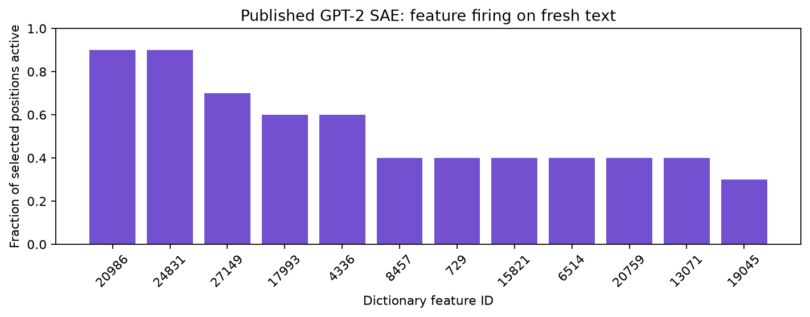

# Use a trained SAE without fitting again

[SAE methods](README.md) · [Model cards and downloads](models/README.md) · [Training protocol](training/README.md)

A probing setup contains two separate models:

| Component | What its weights do | Typical operation |
| --- | --- | --- |
| Backbone language, vision or multimodal model | Produce the activations being analyzed. | `AutoModelForCausalLM.from_pretrained(...)` loads its existing weights. |
| SAE dictionary | Encode those activations into learned feature coefficients and reconstruct them. | `probe.sae.load(...)` loads an existing compatible dictionary. |

A pretrained backbone does not come with a pretrained SAE automatically.
`probe.sae.topk(...)` or another method factory configures a dictionary; it does
not download trained dictionary weights. `.fit(...)` runs the frozen backbone,
captures detached activations and optimizes the SAE's parameters. It does not
fine-tune the backbone. Once a compatible SAE is available, use `.load(...)`
followed by `.run(...)`; neither operation performs optimizer updates.

For a ReLU SAE, load a compatible **ReLU dictionary artifact** with
`probe.sae.load(...)`; the artifact supplies its algorithm and parameters.
You do not call `probe.sae.relu(...)` first. The published example below uses
TopK because that is the selected checkpoint's trained algorithm; choosing
another factory does not convert its weights into a ReLU SAE.

The complete examples on the individual method pages deliberately create a
**random tiny ViT** and synthetic images, then train a **new SAE with a budget of
at most 24 optimizer updates**. Their purpose is to make the entire training/plotting workflow run
on CPU without downloading weights. They are not examples of loading pretrained
SAEs, and their figures do not establish stable semantic concepts.

## Load a published dictionary and analyze new text

The following example loads the published **GPT-2 residual layer 0 TopK SAE**
with 32,768 features and a TopK budget of 32. Its
[model card](models/published/jbloom-gpt2-small-oai-v5-32k-resid-post-saes-c2dcb058-p1.md#sae-6783018355728933dae6d812)
identifies the author weights and source conventions. The loading helper
preserves its per-token layer normalization and verifies the supported
backbone/hook mapping. No training dataset or `.fit(...)` call is required.

Install the version of the library from this branch:

```bash
python -m pip install "vlmprobe[sae,transformers,visualization] @ git+https://github.com/gexinh/vlm-prob.git@dev/sae-v4"
```

Run this complete script from a writable directory. The first run downloads the
pretrained GPT-2 backbone, its tokenizer and the SAE weights; later runs reuse
the cache. Neither backbone weights nor SAE weights are trained by this script.

```python
from pathlib import Path

import matplotlib
matplotlib.use("Agg")
from matplotlib import pyplot as plt
import torch
from transformers import AutoModelForCausalLM, AutoTokenizer

from vlmprobe import Prober, visualization as viz

output = Path("outputs/pretrained_gpt2_sae")
cache = output / "cache"
output.mkdir(parents=True, exist_ok=True)
backbone_id = "openai-community/gpt2"
revision = "607a30d783dfa663caf39e06633721c8d4cfcd7e"
tokenizer = AutoTokenizer.from_pretrained(
    backbone_id, revision=revision, use_fast=True, cache_dir=cache / "backbone",
)
model = AutoModelForCausalLM.from_pretrained(
    backbone_id, revision=revision, dtype=torch.float32,
    attn_implementation="eager", cache_dir=cache / "backbone",
).eval().requires_grad_(False)
probe = Prober(model, tokenizer)
method = probe.sae.from_pretrained(
    "sae-6783018355728933dae6d812", cache_dir=cache / "dictionary", device="cpu",
)

text = "The pathologist examines the tissue under a microscope."
inputs = tokenizer(text, return_tensors="pt", add_special_tokens=False)
result = method.run(inputs)
profile = method.profile(top_k=3).run(inputs)
result.save(output / "features")
profile.save(output / "profile")
method.save(output / "dictionary")  # Save a native artifact for subsequent load().

figure, axis = plt.subplots(figsize=(9, 3.6))
viz.plot_sae_activity(result, top_k=12, ax=axis)
axis.set_title("Published GPT-2 SAE: feature firing on fresh text")
figure.tight_layout()
figure.savefig(output / "feature_activity.png", dpi=160, bbox_inches="tight")
plt.close(figure)
print("Selected positions x dictionary features:", tuple(result.tensors["features"].shape))
print("Mean active features per position:", result.tensors["l0"].float().mean().item())
print("Native artifact:", (output / "dictionary").resolve())
```

The recorded CPU run produced `features[10, 32768]`, with 32 active features at
each selected token position and raw-activation reconstruction MSE `0.06198`.
It performed **zero training updates**. These are measurements on this one
input, not a semantic evaluation or a reconstruction benchmark.



[Execution details, pinned checkpoint checks and code/figure checksums](../../assets/tutorials/sae-pretrained-gpt2-execution.json).

This first automatic pretrained recipe is deliberately specific to the selected
card. The [catalog](models/README.md) also contains other published dictionaries;
their presence is a discovery record, not a promise that every source format
can be loaded automatically. An unsupported `from_pretrained` card ID raises
an error describing the source-conversion route. SAE loading uses our native
dictionary implementation and does not require installing the source SAE
toolkit.

## Inference from your saved native artifact

This example starts with a dictionary already saved by our library, such as
`outputs/pretrained_gpt2_sae/dictionary` from the preceding script.
It contains no fitting step. Supply a dictionary trained on the exact pretrained
GPT-2 checkpoint, tokenizer and loading configuration used below. The same
pattern applies to other models after replacing their model/input preparation.

From the current checkout, install the code being reviewed:

```bash
python -m pip install -e '.[sae,transformers,visualization]'
```

Save the following Python block as `load_native_sae.py`. Set `SAE_ARTIFACT` to an
existing native artifact directory or `best.pt` file, and set `BACKBONE_ID` and
`BACKBONE_REVISION` to the **original backbone repository and immutable revision**
recorded for that dictionary. For example, the backbone repository may be
`openai-community/gpt2`; it is not the SAE weight repository. The script reports
missing settings before attempting a download. Cached Hugging Face files are
reused by `from_pretrained`.

Set those values in your shell before running the script. Replace the path and
revision below with your existing artifact and its original backbone revision:

```bash
export SAE_ARTIFACT="/absolute/path/to/outputs/pretrained_gpt2_sae/dictionary"
export BACKBONE_ID="openai-community/gpt2"
export BACKBONE_REVISION="607a30d783dfa663caf39e06633721c8d4cfcd7e"
python load_native_sae.py
```

```python
import os
from pathlib import Path

import matplotlib
matplotlib.use("Agg")
from matplotlib import pyplot as plt
import torch
from transformers import AutoModelForCausalLM, AutoTokenizer

from vlmprobe import Prober, visualization as viz
from vlmprobe.metrics import TokenMargin

required = ("SAE_ARTIFACT", "BACKBONE_ID", "BACKBONE_REVISION")
missing = [name for name in required if not os.environ.get(name)]
if missing:
    raise SystemExit("Set these environment variables: " + ", ".join(missing))
artifact = Path(os.environ["SAE_ARTIFACT"]).expanduser()
if not artifact.exists():
    raise SystemExit(f"Native SAE artifact not found: {artifact}")
backbone_id = os.environ["BACKBONE_ID"]
revision = os.environ["BACKBONE_REVISION"]
output = Path(os.environ.get("SAE_OUTPUT", "outputs/sae_inference"))
output.mkdir(parents=True, exist_ok=True)
device = "cuda:0" if torch.cuda.is_available() else "cpu"

# Match the original dictionary's backbone loader and tokenizer settings.
tokenizer = AutoTokenizer.from_pretrained(backbone_id, revision=revision, use_fast=True)
model = AutoModelForCausalLM.from_pretrained(
    backbone_id, revision=revision, dtype=torch.float32,
    attn_implementation="eager",
).to(device).eval().requires_grad_(False)
probe = Prober(model, tokenizer)
method = probe.sae.load(artifact, device=device)

# Fresh text enters the backbone; no cached probing outputs are read.
text = "The pathologist examines the"
inputs = tokenizer(text, return_tensors="pt", add_special_tokens=False).to(device)
result = method.run(inputs)
profile = method.profile(top_k=3).run(inputs)
feature_id = int(result.tensors["features"].abs().mean(0).argmax())

# Define an explicit next-token score for intervention comparisons.
positive = tokenizer.encode(" tissue", add_special_tokens=False)
negative = tokenizer.encode(" car", add_special_tokens=False)
if len(positive) != 1 or len(negative) != 1:
    raise ValueError("Choose two single-token candidates for this tokenizer.")
score = TokenMargin(positive[0], negative[0])
reconstruction = method.reconstruct().run(inputs, metric=score)
ablation = method.edit(feature_ids=[feature_id], scale=0).run(inputs, metric=score)

result.save(output / "features")
profile.save(output / "profile")
reconstruction.save(output / "reconstruction")
ablation.save(output / "ablation")
figure, axis = plt.subplots(figsize=(9, 3.6))
viz.plot_sae_activity(result, top_k=min(12, method.sae.config.d_sae), ax=axis)
axis.set_title("Trained dictionary: feature firing on the input text")
figure.tight_layout()
figure.savefig(output / "feature_activity.png", dpi=160, bbox_inches="tight")
plt.close(figure)
print("Selected positions x dictionary features:", tuple(result.tensors["features"].shape))
print("Layer:", method.layer, "method:", method.sae.config.architecture)
print("Reconstruction score change:", reconstruction.tensors["score_change"].tolist())
print("Feature ablation score change:", ablation.tensors["score_change"].tolist())
print("Saved results and plot to:", output.resolve())
```

This second script was also executed with the real artifact saved by the first
script. Its shorter prompt produced `features[5, 32768]`. The recorded changes
in the explicit `tissue`-versus-`car` next-token logit margin were `+0.56057`
for reconstruction and `+1.73342` for the selected feature ablation. These
prompt-specific controls illustrate the outputs; the selected feature has not
been assigned a semantic concept. No fitting occurred during reload or probing.

The artifact supplies the algorithm, layer, dictionary width, feature order,
normalization and default token selection. You do not recreate its training
configuration to run inference. The native loader checks the original model
and tokenizer fingerprints and the adapter's hook contract. A different
checkpoint, tokenizer implementation, precision, architecture, attention
implementation or numerical-stack version can make the binding incompatible;
reload the original configuration rather than relabeling the dictionary.
External input preprocessing must also reproduce its recorded convention.

`features` contains actual coefficients for the selected input positions;
`profile` summarizes activity and its strongest positions. The plot shows
firing frequencies, not named concepts. Reconstruction replaces the activation
with its decoded approximation. Feature ablation retains the reconstruction
error and changes only the selected decoded feature contribution. A measured
score difference concerns this input and intervention; it does not by itself
establish a general semantic interpretation.

## If you downloaded author-published SAE weights

Use the [model cards](models/README.md) to identify the matching backbone,
hook, token/patch selection, normalization and checkpoint download. A published
weight file is a different artifact from the backbone checkpoint. Some source
formats also use different residual coordinates or processed backbone weights.
Matching the hidden width is insufficient.

Our [checkpoint conversion interface](API.md#lower-level-training-artifacts-and-discovery)
converts supported tensor layouts to a native artifact. Conversion preserves
the recorded dictionary math; it does not establish that arbitrary backbone
hooks or preprocessing are equivalent. Follow the selected model's documented
loading recipe. Loading an already trained dictionary should never be replaced
by `.fit(...)` merely to make a weight-format mismatch disappear.

## When fitting is appropriate

Fit a new SAE when there is no suitable pretrained dictionary, when you want
another layer/model/domain, or when your own training data and sparsity recipe
are the object of study. Use independent train/validation source groups and
the [shared training protocol](training/README.md). To continue an interrupted
native run, recreate its original method configuration and resume the matching
training directory. `.fit(...)` on a loaded inference method is rejected;
warm-start fine-tuning of an arbitrary imported dictionary is not currently a
provided training protocol.
