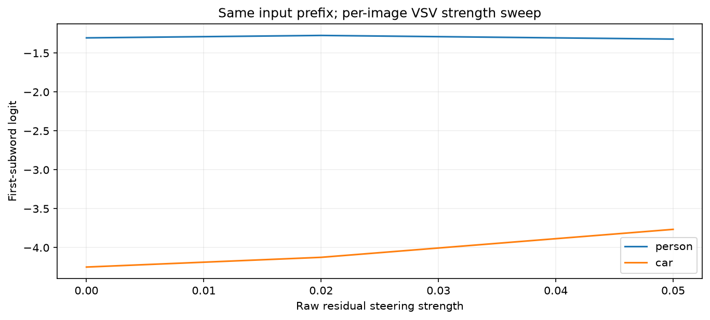

# Residual Steering and VSV

[Home](../../README.md) / [Methods](README.md) / Residual Steering and VSV

Add a supplied residual direction, or construct an image-specific direction from image versus no-image contexts, then measure or generate the changed output.

## API and parameters

```text
method = probe.causal.steer(
    *, layers=None, tokens="visual", strength=1.0, preserve_norm=False, joint=False,
)
result = method.run(inputs, *, direction, metric)
trace = method.forward(inputs, *, direction, capture=())       # joint=True
output = method.generate(inputs, *, direction, max_new_tokens=64, do_sample=False)
```

| Parameter | Default | Meaning and constraints |
| --- | --- | --- |
| `layers` | `None` | All declared residual layers, or one available integer/a nonempty unique subset. |
| `tokens` | `"visual"` | Positions whose residual vectors are edited; `"prediction"` covers the original context end and generated positions when the original prompt layout is preserved. |
| `strength` | `1.0` | Finite signed multiplier in the supplied direction’s raw residual units. Comparable numeric values need not yield comparable relative perturbations across models/layers. |
| `preserve_norm` | `False` | Rescale edited vectors back to their original norms after adding the direction. |
| `joint` | `False` | False measures one independently edited layer per run. True edits all configured layers in the same live forward, required for `forward` and `generate`. |
| `inputs` | required | Native full-sequence model kwargs or `ProbeInputs`, no KV cache. |
| `direction` | required | A floating tensor broadcastable to residual `[B,T,D]`, or `{layer: tensor}`. Use `[D]`, `[1,1,D]`, or `[B,1,D]` for per-example directions; `[B,D]` is not generally batch-safe broadcasting. |
| `metric` | required (`run`) | Scalar/per-example output score, not used by `forward`/`generate`. |
| `capture` | `()` (`forward`) | Names of hook tensors to retain in the actual intervened trace. |
| `max_new_tokens` | `64` (`generate`) | Positive integer maximum generated token count; generation can stop at model EOS earlier. |
| `do_sample` | `False` (`generate`) | Only greedy generation is supported. Passing True is rejected. |

Selections use zero-based **expanded model coordinates**, including image tokens. Common token selectors are `"all"`, `"visual"`, `"text"`, `"last_prompt"`, `"prediction"`, an integer/list of positions, or a boolean `[B,T]` mask. `"last_prompt"` selects one final context token; `"prediction"` additionally selects generated positions when `TokenLayout.prompt` preserves the original context. `"visual"`/`"text"` need a visual-token layout. For text-only examples, explicitly choose `tokens="all"` or `"last_prompt"` rather than the visual-token default.

A metric is a `TokenMargin`, `SequenceLogProb`, or a callable `metric(logits)` returning a scalar or `[B]`; it is evaluated on full-sequence logits. `TokenMargin(positive, negative, position="last_prompt")` compares two vocabulary IDs at one selected prediction position. For multi-token answers, explicitly append answer tokens, preserve the original prompt boundary, and use `SequenceLogProb(answer_mask, reduction="sum")` or `"mean"`. First-subword margins are not complete-answer probabilities.

### Computation and result contracts

Apply `h_edited = h + strength * direction`, optionally restoring the original vector norm. Directions must be finite. Norm preservation rejects an edit that exactly cancels a nonzero vector; originally zero vectors stay zero. `run()` reports baseline, intervention and `effect = intervention - baseline`; scores are `[L,B]` for independent per-layer runs and `[B]` for joint runs, or the corresponding scalar-metric shapes. `forward()` returns a live `ForwardTrace` without a baseline pass.

`generate()` requires joint steering and one unpadded example with native `input_ids` already containing expanded visual placeholders. It replays the **entire prefix and image at every step** without a KV cache, preserves the original prompt boundary, and returns `generated_ids[1,N]`, `fullsequence_ids`, and `metadata["decoded_text"]`. It is an intentionally transparent reference implementation rather than an optimized generation engine.

### Training-free per-image VSV constructor

```text
vectors = probe.causal.vsv(positive, negative, *, layers=None)
# Advanced constructor also exposes tokens="last_prompt":
# VisualSteering.from_inputs(probe, positive, negative, *, layers=None, tokens="last_prompt")
method = vectors.configure(*, strength=0.17, tokens="prediction")
```

| Parameter | Default | Meaning and constraints |
| --- | --- | --- |
| `positive / negative` | required | Image-conditioned and text-only native inputs with exactly the same surrounding text context. Lengths can differ; each must have one context-end position per example. |
| `layers` | `None` | Residual layers from which raw positive-minus-negative context vectors are constructed. |
| `tokens` | `"last_prompt"` (`VisualSteering.from_inputs`) | Optional advanced constructor selector; must select exactly one position per example. The `probe.causal.vsv` shortcut fixes the constructor default. |
| `strength` | `0.17` (`configure`) | Compatibility default, not a calibrated optimum. Set explicitly and inspect a modest sweep for the current model. |
| `tokens` | `"prediction"` (`configure`) | Default edit positions. Configure always uses `joint=True` and `preserve_norm=True`. |

Two unmodified forwards produce `positive_last_context_residual - negative_last_context_residual` per layer. Stored directions are `[B,1,D]` and remain fixed during generation. `vectors.configure(...)` returns the same public steering method, with joint norm-preserving residual edits.

This implements VISTA's VSV residual Equations 4–6; it does **not** implement its separate SLA logit augmentation. The released author code also uses a PCA component, MLP-output edits, and a cosine-dependent scaling rule; those are different controls and are not silently mixed into this residual API. A raw residual strength of 0.17 is not portable from a normalized MLP-output implementation. No classifier, SAE, or model weights are trained by this method.

The complete example loads SmolVLM-500M, reads the raw COCO image, constructs an exact no-image reference, builds directions, generates three live continuations, and plots a fixed-prefix response. First use downloads about 1 GB of model weights; CUDA is recommended. The example strengths are illustrative, not validated optima.

## Complete example: input to output

```python
import os
import hashlib
import urllib.request
from pathlib import Path
import torch
import matplotlib.pyplot as plt
from PIL import Image
from transformers import AutoModelForImageTextToText, AutoProcessor
from vlmprobe import Prober, TokenMargin
from vlmprobe.visualization import plot_input, plot_intervention_curves

# This recipe targets the SmolVLM/Idefics3 image/chat contract.
# First run downloads the 500M model (~1 GB); CUDA is recommended.
model_id = os.environ.get("VLM_PROBING_MODEL", "HuggingFaceTB/SmolVLM-500M-Instruct")
device = os.environ.get("VLM_PROBING_DEVICE", "cuda:0" if torch.cuda.is_available() else "cpu")
dtype = torch.bfloat16 if device.startswith("cuda") else torch.float32
model = AutoModelForImageTextToText.from_pretrained(
    model_id, dtype=dtype, attn_implementation="eager",
).to(device).eval()
processor = AutoProcessor.from_pretrained(model_id)
probe = Prober(model, processor=processor)
assert model.config.model_type == "idefics3", "Use this recipe with SmolVLM; other models need their native input guide"
print({name: info for name, info in probe.describe()["methods"].items()
       if name.startswith("causal.")})
output_dir = Path(os.environ.get("VLM_PROBING_OUTPUT", "outputs/tutorials/causal"))
output_dir.mkdir(parents=True, exist_ok=True)
# A raw COCO image, not an attribution asset or cached model output.
filename = "COCO_val2014_000000310196.jpg"
expected_sha256 = "0dcc39d91764e59e0e01c11b92ec31320f094a87ca2dce5e0c56c4f1a361daf4"
custom_image = os.environ.get("VLM_PROBING_IMAGE")
root = next((p for p in [Path.cwd(), *Path.cwd().parents]
             if (p / "demos/assets/images" / filename).is_file()), None)
image_path = Path(custom_image) if custom_image else (root / "demos/assets/images" / filename if root else output_dir / filename)
if custom_image and not image_path.is_file():
    raise FileNotFoundError(image_path)
if not image_path.is_file():
    url = "https://s3.amazonaws.com/images.cocodataset.org/val2014/" + filename
    with urllib.request.urlopen(url, timeout=60) as response:
        image_path.write_bytes(response.read())
if not custom_image:
    assert hashlib.sha256(image_path.read_bytes()).hexdigest() == expected_sha256
image = Image.open(image_path).convert("RGB")
question = "Please help me describe the image in detail."
messages = [{"role": "user", "content": [
    {"type": "image"}, {"type": "text", "text": question},
]}]
prompt = processor.apply_chat_template(messages, tokenize=False, add_generation_prompt=True)
values = dict(processor(text=prompt, images=image, return_tensors="pt"))
positive = {key: value.to(device=device, dtype=dtype if value.is_floating_point() else value.dtype)
            if isinstance(value, torch.Tensor) else value for key, value in values.items()}
# SmolVLM surrounds all image crops/global image tokens with a contiguous wrapper span.
# Remove that entire span; preserve the exact tokenized text on either side.
wrapper_id = processor.fake_image_token_id
wrappers = (positive["input_ids"][0] == wrapper_id).nonzero().flatten()
assert wrappers.numel() >= 2, "Expected SmolVLM image wrapper tokens"
keep = torch.ones(positive["input_ids"].shape[1], dtype=torch.bool, device=device)
keep[int(wrappers[0]):int(wrappers[-1]) + 1] = False
negative = {"input_ids": positive["input_ids"][:, keep].clone(),
            "attention_mask": positive["attention_mask"][:, keep].clone()}
assert torch.equal(negative["input_ids"], positive["input_ids"][:, keep])
print("Positive prompt:", prompt)
print("Text-only reference:", processor.tokenizer.decode(negative["input_ids"][0]))
print("Positive/reference token counts:", positive["input_ids"].shape[1], negative["input_ids"].shape[1])
ax = plot_input(image, prompt=question, title="Raw COCO input")
ax.figure.savefig(output_dir / "causal-vsv-input.png", dpi=150, bbox_inches="tight")
plt.show()
# No training: directions are positive-minus-negative last-context residuals.
vectors = probe.causal.vsv(positive, negative, layers=None)
print("Direction construction:", vectors.metadata)
strengths = [0.0, 0.02, 0.05]
max_new_tokens = int(os.environ.get("VLM_PROBING_MAX_NEW_TOKENS", "32"))
# These are exact vocabulary-token logits, not complete word probabilities.
candidates = {word: processor.tokenizer.encode(word, add_special_tokens=False)[0]
              for word in ("person", "car")}
print("Fixed-prefix subwords:", {word: processor.tokenizer.decode([token])
                                  for word, token in candidates.items()})
responses = {word: [] for word in candidates}
captions = {}
for strength in strengths:
    method = vectors.configure(strength=strength, tokens="prediction")
    # All strengths see this same original prompt in this diagnostic.
    trace = method.forward(positive, direction=vectors.directions)
    for word, token in candidates.items():
        responses[word].append(float(trace.logits[0, -1, token]))
    del trace
    output = method.generate(positive, direction=vectors.directions,
                             max_new_tokens=max_new_tokens, do_sample=False)
    captions[strength] = output.metadata["decoded_text"][0]
    print(f"Strength {strength}: {captions[strength]}")
    output.save(output_dir / f"vsv_strength_{strength:g}")
ax = plot_intervention_curves(
    {word: {"x": strengths, "y": values} for word, values in responses.items()},
    xlabel="Raw residual steering strength", ylabel="First-subword logit",
    title="Same input prefix; per-image VSV strength sweep",
)
ax.figure.savefig(output_dir / "causal-vsv.png", dpi=150, bbox_inches="tight")
plt.show()
# Persist the complete generated continuations, not selected favorable excerpts.
import json
(output_dir / "vsv_captions.json").write_text(json.dumps({
    "model": model_id, "prompt": prompt, "construction": vectors.metadata,
    "max_new_tokens": max_new_tokens, "captions": captions,
    "candidate_ids": candidates, "fixed_prefix_logits": responses,
}, indent=2) + "\n")
```
### Interpreting the result and changing models

A larger scale can introduce unsupported details, repetition, or no useful improvement. Inspect the **full generated output** and compare both desired and undesirable changes; a fixed-prefix token logit is not a hallucination score. The additive relative perturbation is `strength * ||direction|| / ||residual||`, so equal strengths can behave differently by model/layer.

The steering factories are shared across supported residual adapters. Native processor/chat templates and visual wrappers remain model-specific. The code explicitly targets SmolVLM/Idefics3: replacing its model ID with an unrelated VLM without changing that input recipe is not supported. Use that model’s [guide](../models/README.md), preserve exact text IDs in the no-image reference, and ensure native expanded visual placeholders are available before generation.

For a custom direction, call `probe.causal.steer(...)` directly and supply `direction` to `run`/`forward`/`generate`. For text-only steering, explicitly choose `tokens="last_prompt"` or `"prediction"`; the default visual selector has no selected text-model positions.

[Live notebook](../../demos/steering_vsv_demo.ipynb) · [Standalone script](../../examples/tutorials/causal_steering_vsv.py) · [VISTA paper](https://arxiv.org/abs/2502.03628) · [VSV implementation](../../src/vlm_probing/causal/visual_steering.py)

## Example visualization

Generated live on **SmolVLM-500M**, using the same original image/prompt for each diagnostic point. The curve displays the first vocabulary subword; full captions are retained in the live notebook and output JSON.


