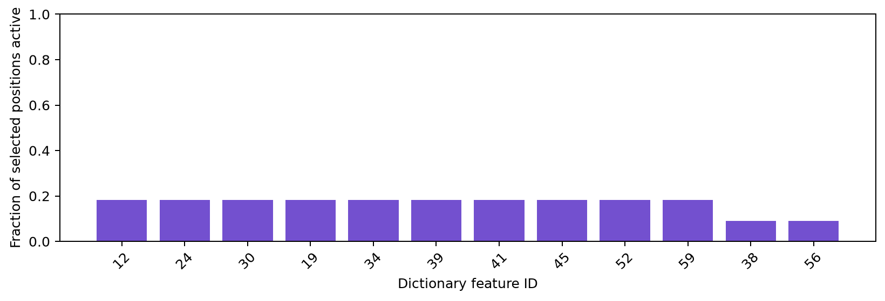

# Sparse autoencoders: train, inspect, and intervene

For the integrated SAELens, ViT-Prisma and Overcomplete providers, model catalog
and shared probing extensions, see the [SAE platform guide](sae/README.md).

Sparse autoencoders (SAEs) add a fourth family alongside Lens, Attention and
Causal. They learn a sparse dictionary of directions in a model's activations.
The model stays frozen. A dictionary feature is an empirical direction, **not a
named concept, a diagnosis, or a demonstrated causal mechanism**.

This development version includes ReLU + L1, TopK and Gated dictionaries;
training on your own activation data; portable checkpoints; model-bound feature
readouts; and feature interventions with an explicit reconstruction control.

## Algorithms and scope

For activation vector `x`, the encoder produces sparse feature activations `z`;
the decoder reconstructs `x_hat`. The training objective combines reconstruction
error with an architecture-specific sparsity objective.

| Architecture | Sparsity mechanism | Relevant work |
|---|---|---|
| `relu` | Nonnegative ReLU features with an L1 penalty | [Towards Monosemanticity: Decomposing Language Models With Dictionary Learning](https://transformer-circuits.pub/2023/monosemantic-features/index.html) |
| `topk` | Keep at most `k` positive activations per input vector | [Scaling and evaluating sparse autoencoders](https://arxiv.org/abs/2406.04093) |
| `gated` | Separate feature selection from magnitude, with a sparsity and auxiliary reconstruction objective | [Improving Dictionary Learning with Gated Sparse Autoencoders](https://arxiv.org/abs/2404.16014) |

These are implementations of the core architecture families, not claims of a
paper-scale reproduction. Defaults, input normalization, data and evaluation
must be reported when comparing dictionaries. TopK does not identify the same
feature IDs as ReLU or Gated, or as another independently trained SAE.

For the native kernels, `u = x / training_rms`, `u_hat = W_dec z + b_dec`, and
`decode(z) = training_rms * u_hat`. ReLU uses
`z = relu(W_enc (u - b_dec) + b_enc)` and minimizes the mean per-vector summed
squared reconstruction error plus `l1_coefficient * ||z||_1`. Decoder feature
columns are normalized after optimizer steps. TopK replaces the ReLU output
with the `k` largest positive preactivations and uses reconstruction loss; this
version does **not** include the paper's AuxK dead-feature objective. Gated uses
a hard selection gate, separately scaled magnitude directions, an L1 gate
penalty, and an auxiliary reconstruction path whose decoder and centering bias
are detached. Logged total losses are normalized-coordinate sums per vector;
reported raw-space MSE is per activation coordinate.

## API and parameters

### Configure and fit a dictionary

```python
from vlmprobe.sae import SAEConfig, SparseAutoencoder
from vlmprobe.sae.training import train_sae, evaluate_sae
from vlmprobe.sae.binding import build_sae_binding

config = SAEConfig(
    architecture="relu", d_in=768, d_sae=3072,
    k=32, l1_coefficient=0.01, seed=0,
)
sae = SparseAutoencoder(config, binding=binding, device="cpu", dtype=torch.float32)
history = train_sae(
    sae, train_batches, validation_batches, checkpoint_dir,
    epochs=10, lr=1e-3, patience=3, min_delta=1e-4,
    seed=0, resume=True, provenance=None, progress_every=20,
)
```

| Parameter | Meaning |
|---|---|
| `architecture` | `"relu"`, `"topk"`, or `"gated"`. |
| `d_in` | Native activation width at the selected model layer. Must match the model. |
| `d_sae` | Number of dictionary features. Larger dictionaries need more data and memory. |
| `k` | Maximum retained positive features for TopK; must be valid for the dictionary width. |
| `l1_coefficient` | Strength of the sparsity penalty for architectures using an L1 objective. |
| `seed` in `SAEConfig` | Dictionary initialization seed. |
| `binding` | Exact model/layer/representation/hook/tokenizer/preprocessing/calibration identities. |
| `device`, `dtype` | SAE parameter device and floating-point dtype; independent of the frozen model. |
| `train_batches` | Re-iterable training batches: floating `[positions, d_in]` tensors or dictionaries with `"activations"`. Padding should already be removed. |
| `validation_batches` | Independent, re-iterable validation batches. Never pass test data here. |
| `checkpoint_dir` | Directory containing the best portable artifact, optimizer resume state and logs. |
| `epochs` | Maximum cumulative epochs; it may be increased when resuming. |
| `lr` | Adam learning rate. |
| `patience`, `min_delta` | Stop after this many epochs without the specified improvement in validation objective. |
| `seed` in `train_sae` | Training RNG seed. Pass an explicit generator to a shuffled DataLoader for resumable loader order. |
| `resume` | Restore compatible optimizer/model/RNG history if a training state exists. Mismatched configuration, binding or provenance is rejected. |
| `provenance` | Caller-supplied data fingerprints, split definitions and preprocessing records; checked on resume. |
| `progress_every` | Positive number of training steps between progress-status writes. |

Normalization and the reconstruction bias initialize from **training activations
only**. Validation chooses `best.pt`; `training_state.pt` stores the resumable
optimizer state. `history.json` and `status.json` expose progress. Fit and evaluate
outside `torch.inference_mode()`; gradient computation is needed for the SAE.

`evaluate_sae(sae, batches, reference_mean=training_mean)` reports reconstruction
and sparsity metrics including MSE, fraction of variance unexplained (FVU), mean
L0 and dead-feature fraction. The explicit training mean gives FVU a common
reference across splits. Without a reference mean, report the evaluator's
documented split-specific variance convention rather than comparing unlike
denominators.

### Bind the dictionary to your model

```python
binding = build_sae_binding(
    probe, layer=7,
    model_id="sha256:actual-frozen-model-weight-fingerprint",
    tokenizer_id="sha256:tokenizer-files-fingerprint",
    preprocessing_id="sha256:image-and-text-processing-configuration",
    calibration_id="sha256:training-and-validation-manifest",
)
```

The helper records the actual adapter's module path, hook kind, selector, tensor
slice, residual layer and representation. Caller-provided identities must describe
the artifact's real model/data. Runtime validation checks the hook and exact
artifact binding; it does **not** rehash all of the loaded model weights to verify
that a supplied checksum is truthful. Keep the extraction manifest with the SAE.
Changing the model, hook, tokenizer, preprocessing or calibration corpus requires
an appropriate new binding and usually a new dictionary.

### Read sparse features

```python
method = probe.sae.features(
    layer=7, sae=sae, binding=binding, tokens="all",
)
# Alternatively use checkpoint="outputs/my_sae/best.pt" instead of sae=sae.
result = method.run(inputs)
```

| Parameter | Meaning |
|---|---|
| `layer` | Exactly one integer residual layer available in `probe.describe()`. |
| `sae`, `checkpoint` | Supply exactly one fitted `SparseAutoencoder` or native checkpoint path. |
| `binding` | Explicit expected artifact binding, including the real hook contract. |
| `tokens` | `"all"`, `"visual"`, `"text"`, `"last_prompt"`, token positions or a boolean mask. Padding is excluded; explicit padding selections are rejected. |
| `inputs` | Native model-input dictionary or `ProbeInputs`, prepared as in the model guide. |

The `ProbeResult` contains:

| Tensor | Shape | Meaning |
|---|---|---|
| `features` | `[N, F]` | Sparse nonnegative feature activations. |
| `activation` | `[N, D]` | Selected native model activations, represented in the SAE dtype. |
| `reconstruction` | `[N, D]` | Decoded reconstruction in native activation units. |
| `reconstruction_error` | `[N, D]` | `activation - reconstruction`. |
| `positions` | `[N, 2]` | Actual `[batch, expanded_token]` coordinates. |
| `l0` | `[N]` | Number of nonzero features for each selected position. |

`N` packs selected non-padding positions, `D = d_in` and `F = d_sae`. Public
model-bound methods reject unfitted dictionaries. Low-level kernels remain
available for explicit initialization/reconstruction baselines.

### Test feature interventions

```python
edited = probe.sae.edit(
    layer=7, sae=sae, binding=binding, tokens="visual",
    feature_ids=[15, 42], scale=0.0, mode="error_preserving",
).run(inputs, metric=metric)
```

| Parameter | Meaning |
|---|---|
| `feature_ids` | Nonempty unique integer dictionary indices. They are not vocabulary IDs. |
| `scale` | Finite multiplier for the selected encoded activations: `0` ablates, `1` retains, larger values amplify. |
| `mode` | `"error_preserving"` keeps the original reconstruction residual; `"reconstruction"` replaces the selected native activations by the edited SAE reconstruction. |
| `metric` | Optional VLMProbe metric, such as `TokenMargin`, `SequenceLogProb` or `ClassScore`. If omitted, logits are still returned. |

For `z = E(x)` and edited `z_edit`, the default intervention is
`x_edit = x + D(z_edit) - D(z)`. Thus the SAE's reconstruction error remains in
the model. `scale=1` in this mode is an exact no-op. In reconstruction mode,
`x_edit = D(z_edit)`; even `scale=1` is a reconstruction intervention and should
be measured as its own control.

Mixed-precision execution forms the decoded difference in SAE precision, then
adds that difference to the original native activation. The native baseline is
never rounded through the SAE dtype. Ablating an already inactive feature
therefore remains an exact no-op even without the scale-one shortcut.

Outputs are `baseline_logits`, `edited_logits`, and selected `positions`.
Supplying a metric adds `baseline_score`, `edited_score`, and
`score_change = edited_score - baseline_score`. Run feature edits independently
on the same input before comparing effects. The original model's parameters,
gradients and individual module training flags are preserved.

## Complete CPU example: input → frozen activations → training → features → plot

This self-contained example uses an intentionally small **randomly initialized**
GPT-2 and an explicit vocabulary. It demonstrates the training and API contract,
not meaningful pathology concepts or pretrained language performance. Replace
the model and tokenizer with your model guide's loaded pretrained checkpoint for
a scientific experiment; keep the same feature/edit API and split protocol.

Install the development checkout and optional dependencies first:

```bash
pip install -e '.[transformers,visualization]'
```

```python
import hashlib
import json
from pathlib import Path

import torch
from transformers import GPT2Config, GPT2LMHeadModel
from vlmprobe import Prober, TokenMargin
from vlmprobe import visualization as viz
from vlmprobe.sae import SAEConfig, SparseAutoencoder
from vlmprobe.sae.binding import build_sae_binding
from vlmprobe.sae.training import train_sae, evaluate_sae

torch.manual_seed(42)
torch.set_num_threads(1)
output = Path("outputs/sae_cpu")
output.mkdir(parents=True, exist_ok=True)

words = ["[PAD]", "the", "tumor", "cells", "have", "irregular", "nuclei",
         "stroma", "is", "fibrous", "dark", "and", "tissue", "contains",
         "normal", "cell", "clusters"]
vocab = {word: index for index, word in enumerate(words)}
texts = {
    "train": ["the tumor cells have irregular nuclei", "the stroma is fibrous",
              "the tissue contains dark nuclei", "the cells have nuclei"],
    "validation": ["the tumor cells have dark nuclei", "the tissue contains fibrous stroma"],
    "test": ["the tissue contains tumor cell clusters", "the normal cells have nuclei"],
}

def encode(rows):
    ids = [[vocab[word] for word in text.split()] for text in rows]
    width = max(map(len, ids))
    values = torch.zeros(len(ids), width, dtype=torch.long)
    mask = torch.zeros_like(values)
    for row, tokens in enumerate(ids):
        values[row, :len(tokens)] = torch.tensor(tokens)
        mask[row, :len(tokens)] = 1
    return {"input_ids": values, "attention_mask": mask, "use_cache": False}

model = GPT2LMHeadModel(GPT2Config(
    vocab_size=len(vocab), n_embd=32, n_layer=2, n_head=4, n_positions=32,
    resid_pdrop=0.0, embd_pdrop=0.0, attn_pdrop=0.0, use_cache=False,
)).eval()
model.requires_grad_(False)
probe = Prober(model)
layer = 0
site = probe.spec.residuals[layer]

# These are actual frozen-model forwards, not cached demonstration results.
def collect(rows):
    inputs = encode(rows)
    trace = probe.adapter.run(inputs, capture=[site])
    valid = inputs["attention_mask"].bool()
    return trace.activations[site][valid].detach().cpu()

activations = {split: collect(rows) for split, rows in texts.items()}
weight_hash = hashlib.sha256()
for name, value in sorted(model.state_dict().items()):
    weight_hash.update(name.encode())
    weight_hash.update(value.detach().cpu().contiguous().numpy().tobytes())
binding = build_sae_binding(
    probe, layer,
    model_id="sha256:" + weight_hash.hexdigest(),
    tokenizer_id="sha256:" + hashlib.sha256(json.dumps(vocab, sort_keys=True).encode()).hexdigest(),
    preprocessing_id="whitespace-integer-vocab-v1|right-padding|remove-padding-before-fit",
    calibration_id="sha256:" + hashlib.sha256(json.dumps(
        {key: texts[key] for key in ("train", "validation")}, sort_keys=True).encode()).hexdigest(),
)
sae = SparseAutoencoder(SAEConfig(
    architecture="topk", d_in=32, d_sae=64, k=4,
    l1_coefficient=0.01, seed=42,
), binding=binding)
history = train_sae(
    sae, list(activations["train"].split(16)),
    list(activations["validation"].split(16)), output / "training",
    epochs=8, lr=1e-3, patience=3, seed=42,
    provenance={"split_unit": "independent example text", "binding": binding},
)

# Hold test data back until after validation has selected the checkpoint.
test_metrics = evaluate_sae(
    sae, [activations["test"]], reference_mean=activations["train"].mean(0),
)
print("Test reconstruction/sparsity:", test_metrics)
result = probe.sae.features(layer=layer, checkpoint=output / "training/best.pt",
                            binding=binding, tokens="all").run(encode(texts["test"]))
print("Feature matrix:", result.tensors["features"].shape)
print("Token coordinates:", result.tensors["positions"])
print("Features active per token:", result.tensors["l0"])
ax = viz.plot_sae_activity(result, top_k=12)
ax.figure.savefig(output / "feature_activity.png", dpi=180, bbox_inches="tight")

feature_id = int((result.tensors["features"] != 0).sum(0).argmax())
metric = TokenMargin(vocab["tumor"], vocab["normal"])
effect = probe.sae.edit(layer=layer, sae=sae, binding=binding, tokens="all",
    feature_ids=[feature_id], scale=0.0).run(encode(texts["test"]), metric=metric)
print("Selected-feature intervention score change:", effect.tensors["score_change"])
```

The plot displays the fraction of selected positions activating each feature,
with actual feature IDs. It does not supply semantic labels for those features.
Inspect high-activation examples and matched interventions before interpreting
any feature as a concept.

The example was executed on CPU in this development version. It produced an
`[11, 64]` test feature matrix, exactly four active features per token, and
`outputs/sae_cpu/feature_activity.png`. These are pipeline checks on a random
model; they are not pathology evidence.



## Use your own dataset with the command-line workflows

The extraction script accepts a JSONL manifest such as:

```json
{"id":"train-001","split":"train","group":"source-document-1","text":"Describe the observed tissue."}
{"id":"val-001","split":"validation","group":"source-document-2","text":"Describe the cellular morphology."}
{"id":"test-001","split":"test","group":"source-document-3","text":"Describe the tissue architecture."}
```

Use enough independent source groups and observations for your experiment; the
three lines above illustrate the schema only. Every record needs a unique `id`,
one of the three `split` values, a source `group` and input `text`. Source groups
must not cross splits. For a VLM, add an `image` path relative to the manifest
directory (or an absolute path), and pass `--vlm --tokens visual`.

```bash
python examples/cache_sae_activations.py \
  --manifest my_data/manifest.jsonl --output outputs/my_sae/activations.pt \
  --model /path/to/local/pretrained-model --layer 0 --tokens all --device cuda:0

python examples/train_sae.py \
  --activations outputs/my_sae/activations.pt --output-dir outputs/my_sae/topk \
  --architecture topk --d-sae 4096 --k 32 --l1-coefficient 0.01 \
  --epochs 10 --batch-size 512 --lr 0.001 --patience 3 --seed 42 --device cuda:0
```

The first command performs real frozen-model forwards and records source groups
for every retained activation row. It resolves an immutable HF revision or hashes
local checkpoint files and tokenizer state; explicit `--model-id` and
`--tokenizer-id` can supply a separately verified immutable identity. Optional
`--revision` selects the model revision, `--max-length` bounds input length and
`--image-side` bounds an image before native processor resizing. These choices
are part of preprocessing provenance. Choose an available layer using the model
guide and `probe.describe()`; method calls are otherwise the same across models.

The training command checks source groups and split dimensions before fitting.
To create the activation bundle yourself, provide `binding`, floating
`train`, `validation` and `test` tensors of shape `[N, D]`, and
`groups = {"train": [...], "validation": [...], "test": [...]}` with a source
group string per tensor row. Raw tensors contain neither the model forward nor
the image geometry, so retain those records in accompanying provenance.

An additional `--pathology-cache` workflow can convert the separately audited
pathology pilot's frozen visual features; it requires the matching `--model`
directory and `--layer`. It does not substitute generated outputs for a new
user's own extraction.

## Image feature maps

For a supported VLM, prepare the image and prompt with its model guide and use
the same public methods with `tokens="visual"`. Train on visual activations if
you intend to analyze the visual distribution, and retain native image geometry.

`viz.plot_sae_feature_overlay(processed_image, result, feature_id=15,
grid_shape=[rows, columns], image_alpha=0.2)` maps the chosen feature onto the
**actual processed image** corresponding to that single visual grid. The image
opacity is reduced while feature-map opacity remains one. Supply the real grid;
do not infer it from the token count or overlay tiled tokens on an unrelated
original image. Multiple images, videos and adaptive crops require separate
alignment per grid. Feature activation maps are not attention maps, despite
sharing the overlay renderer.

## Training and evaluation protocol

1. Freeze a specific model checkpoint and choose one actual layer/hook. Cache
   selected raw activations with model/tokenizer/preprocessing fingerprints.
2. Split by independent source document, patient or source slide **before**
   extracting rows. A token-level random split is not an independent evaluation.
3. Fit normalization, biases and SAE parameters from training data only. Use
   validation for checkpoint selection and architecture/hyperparameter choices.
4. Evaluate held-out reconstruction, sparsity, dead features and downstream
   behavior. Compare error-preserving feature edits against reconstruction-only
   changes. A good reconstruction score alone does not establish interpretability.
5. Preserve the binding, data/split hashes, architecture, normalization, optimizer
   settings and checkpoint-selection rule with each artifact.

## External pretrained checkpoints

Native `SparseAutoencoder.load` accepts this library's artifact format. Do not
point it directly at arbitrary SAELens, Goodfire or Gemma Scope files. A separate
optional adapter exposes this interface:

```python
from vlmprobe.sae import SAELensAdapter

# `loaded_sae` is an already loaded compatible SAELens module.
external = SAELensAdapter(
    loaded_sae, binding=binding, expected_binding=binding,
    source_metadata={"release": "the-exact-external-release"},
)
result = probe.sae.features(layer=layer, sae=external,
                            binding=binding, tokens="all").run(inputs)
```

For explicit downloading, `SAELensAdapter.from_pretrained(release, sae_id,
binding=binding, expected_binding=binding, device="cpu", dtype="float32")` uses
the verified SAELens **v6** loader. Install `sae-lens>=6,<7` only if you need that
backend. The initial bridge accepts `normalize_activations="none"`, an explicit
`apply_b_dec_to_input` setting and no head reshaping. Other normalization schemes
fail explicitly. Backend hook names are not translated automatically: verify
their actual native module correspondence and add the exact
`backend_hook_name`, plus model/tokenizer backend names where needed, to the
artifact binding. The adapter preserves source metadata and calls the backend's
own `encode`/`decode`.

Matching hidden width or layer numbers alone never proves compatibility. This
version supplies a restricted bridge and custom-data training; it does not claim
that every external release is usable without further verification.
