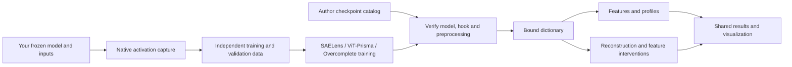

# Sparse features across language and vision

[Home](../../README.md) / [Native SAE guide](../sae.md)

VLMProbe combines a versioned checkpoint catalog, optional native SAE toolkits,
and shared probing tools. Train or load a dictionary through its original
backend, verify the model and activation coordinates, then use the same
`probe.sae` methods and visualization functions.



## Providers and methods

| Provider | Integrated architectures | Pretrained resources | Training protocol |
| --- | --- | --- | --- |
| [Native VLMProbe](../sae.md) | ReLU + L1, per-token TopK, Gated | Your trained artifacts | Train-only RMS/mean, independent validation, early stopping and resumable Adam |
| [SAELens](saelens.md) | Standard, Gated, TopK, JumpReLU, AbsTopK, Matching Pursuit; BatchTopK and Matryoshka BatchTopK training with native inference conversion | Official registry, including GPT-2, Gemma/GemmaScope, Llama/LlamaScope and Goodfire resources | Upstream `SAETrainer` with caller-supplied activation batches and explicit sample budget; optional independent final validation |
| [ViT-Prisma](prisma.md) | Native Standard ReLU/TopK and Gated | Official CLIP and DINO dictionaries; residual/MLP and CLS/patch conventions remain explicit | Native Prisma objectives on supplied activations or image datasets, frozen HookedViT capture, validation and resumable Adam |
| [Overcomplete](overcomplete.md) | ReLU, TopK, BatchTopK, JumpReLU, relaxed-archetypal TopK/JumpReLU | Caller-trained or caller-loaded dictionaries; no central pretrained SAE registry | Upstream `train_sae`, persistent optimizer, independent validation and safe artifacts |

SAELens's dictionary and activation-source abstractions also support vision and
multimodal activations. Its high-level language-model runner is an LM-specific
convenience layer. Overcomplete also offers NMF, PCA and other dictionary-learning
tools; these are not represented as SAE architectures here.

The native TopK implementation remains the core per-token rule without AuxK.
Backend training retains upstream objectives: for example, Overcomplete's
BatchTopK uses a global training-batch activation budget, and its default
JumpReLU trainer uses MSE + L1 rather than claiming the original paper's L0 recipe.

## Installation

Use the local development checkout for these additions:

```bash
python -m pip install -e ".[transformers,visualization]"
```

Install optional providers in an environment compatible with their dependencies:

```bash
# SAELens v6
python -m pip install -e ".[saelens]"

# Overcomplete 0.3: Python <3.13 and Matplotlib 3.8.x
python -m pip install -e ".[overcomplete]"

# ViT-Prisma: use the audited source, not the older PyPI API.
python -m pip install "git+https://github.com/Prisma-Multimodal/ViT-Prisma.git@64daf1425f7e5311844213fd0fb6f4127a30cd16"
```

ViT-Prisma's audited source declares 2.0.0, while PyPI currently exposes 0.1.4.
There is no misleading `prisma` extra that installs that different API. Avoid its
legacy `[sae]` extra when using SAELens v6: it pins SAELens 2.1.3. Separate
environments are useful when toolkit dependency requirements differ. Catalog
search and native VLMProbe methods do not require these optional toolkits.

## Discover checkpoints without loading weights

```python
from vlmprobe.sae import list_backends, list_pretrained, catalog_provenance

print(list_backends())
clip_candidates = list_pretrained("prisma", model="CLIP", query="hook_resid_post", limit=10)
llama_candidates = list_pretrained("saelens", model="llama", limit=10)
print(clip_candidates[0])
print(catalog_provenance()["snapshot_date"])

# Query the currently installed SAELens registry instead of the bundled snapshot.
# Requires the optional package, but still does not download weights.
# current = list_pretrained("saelens", source="installed", release="gemma-scope-2b-pt-res")
```

The compressed offline snapshot contains **13,857 SAELens registry entries** and
**82 ViT-Prisma table entries**, collected on 2026-10-19. The Prisma resources
include **71 SAEs and 11 transcoders**. Registry entries can describe methods
outside the same-space SAE adapter contract; those entries remain visible and
are marked separately. Most entries are listings or checked configs, not
downloaded and numerically verified weights.

Two records have `weights_verified=True` after actual CPU dictionary
encode/decode checks. Their `verification_scope` explicitly limits this evidence
to test vectors; it does not claim a verified backbone or preprocessing transfer.

Every record preserves source URLs and available model, hook, dimensions,
normalization, revision and license metadata. Unknown fields stay unknown.
Matching dimensions do not establish checkpoint compatibility. In particular,
TransformerLens processing, OpenCLIP-to-HookedViT conversion, CLS selection and
image normalization can change the representation.

Search from the command line or generate a standalone searchable catalog:

```bash
python examples/sae_catalog.py --backend prisma --model DINO --limit 5
python examples/sae_catalog.py --backend saelens --query Goodfire --limit 10
python examples/sae_catalog.py --html outputs/sae_catalog.html
```

`examples/build_sae_catalog.py` rebuilds the compressed snapshot from exported
provider metadata. It records source commits, input hashes and resource kinds;
it does not download or bundle model weights.
Optional `--verification-json` input attaches recorded numerical checks and
their scope to the matching catalog identities.

## Load or train using a provider

Common entry points deliberately retain each provider's native options:

| API | Meaning |
| --- | --- |
| `list_backends()` | Capabilities, sources and installed-package metadata; no optional package import |
| `list_pretrained(backend=None, model=None, query=None, limit=None, source="snapshot")` | Search checkpoint metadata; `source="installed"` asks that provider's discovery function |
| `load_sae(backend, binding=..., **native_options)` | Load a provider checkpoint using its verified loader |
| `wrap_sae(backend, model, binding=..., **native_options)` | Adapt a caller-loaded upstream dictionary |
| `train_backend(backend, **native_options)` | Execute the provider-specific documented training protocol |
| `probe.sae.load(backend, binding=..., **native_options)` | Validate the current model's declared hook before loading |

The [SAELens](saelens.md), [Prisma](prisma.md) and
[Overcomplete](overcomplete.md) guides each contain a complete executed example,
API parameters, input preparation, training, checkpoint restore, output and
visualization. The native [own-data activation CLI](../sae.md#use-your-own-dataset-with-the-command-line-workflows)
can also collect frozen activations for these workflows.

Upstream training algorithms are not silently replaced by one common loss.
SAELens uses its native sample-budget trainer. Prisma's cached-activation path
avoids the native image runner's hardcoded ImageNet-size schedule for custom
datasets. Overcomplete preserves its native criterion and batch semantics.
Each protocol reports validation, resume restrictions and its produced files.

## Shared probing and visualization

After loading or training, the dictionary is a compatible `sae` object and its
`binding` records the actual model, layer, module hook and preprocessing:

```python
# `probe`, `inputs`, `sae` and `binding` are created end-to-end in the provider guides.
features = probe.sae.features(
    layer=layer, sae=sae, binding=binding, tokens="visual",
).run(inputs)

profile = probe.sae.profile(
    layer=layer, sae=sae, binding=binding, tokens="visual", top_k=5,
).run(inputs)
print(profile.tensors["firing_frequency"])
print(profile.tensors["top_positions"])  # [K, features, batch/token coordinate]

reconstruction = probe.sae.reconstruct(
    layer=layer, sae=sae, binding=binding, tokens="visual",
).run(inputs)

ablation = probe.sae.edit(
    layer=layer, sae=sae, binding=binding, tokens="visual",
    feature_ids=[feature_id], scale=0., mode="error_preserving",
).run(inputs, metric=your_metric)
```

`profile` reports mean, variance, nonzero frequency and top positions ranked by
absolute activation, retaining signed values. `reconstruct` replaces selected
native states with the decoded reconstruction. Default `edit` changes only the
chosen decoded feature contributions while preserving reconstruction error:

```text
native edited state = original native state + decode(edited features) - decode(original features)
```

Both decodes use the same input-specific normalization context where required.
Identity edits are exact no-ops. Feature maps use actual token coordinates and
explicit image grids; signed dictionaries retain signed visualization scales.

```python
from vlmprobe import visualization as viz

ax = viz.plot_sae_feature_overlay(
    processed_image, features, feature_id=feature_id,
    grid_shape=(rows, columns), image_alpha=0.2,
)
ax.figure.savefig("outputs/feature.png", bbox_inches="tight")
```

Native vision encoders can return representation vectors rather than logits.
Those adapters report `output_kind="representation"`; interventions return
`baseline_output` / `edited_output` and accept vector metrics. They do not label
embedding coordinates as class scores or vocabulary logits. Other model kinds
retain `baseline_logits` / `edited_logits`.

Transcoders, temporal SAEs and geometry-dependent attention/convolutional
encoders need different input/output contracts. They are not attached to a
residual simply because their widths match. Feature IDs are not automatically
named concepts, and integration smoke tests are separate from performance or
semantic evaluation.

## Sources and verification

The integrations delegate computation to the original optional libraries:
[SAELens](https://github.com/decoderesearch/SAELens),
[ViT-Prisma](https://github.com/Prisma-Multimodal/ViT-Prisma), and
[Overcomplete](https://github.com/KempnerInstitute/overcomplete).
The [v2 version note](../versions/sae-v2.md) records the implementation scope,
exact source revisions, tests and experiments. Source-library licenses and
individual checkpoint licenses remain separate metadata.
