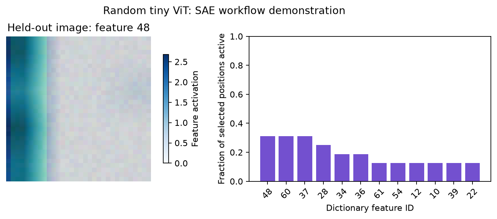

# Live image-to-feature tutorial

[SAE hub](../README.md) · [Parameters](../API.md) · [Training](../training/README.md)

This CPU example constructs image inputs, runs a frozen HF ViT, trains a TopK
dictionary on intermediate **visual patch activations**, reads held-out features,
measures reconstruction/feature controls, saves a native artifact/model card,
reloads it and uses the shared visualization toolkit. It does not load prepared
results. The small ViT has **random weights** and the images are procedural:
this is a runnable interface example, not evidence of meaningful visual concepts.

```bash
python -m pip install -e ".[sae,transformers,visualization]"
python examples/sae_quickstart.py --output-dir outputs/sae_quickstart
# Same trainer and IO; choose another native algorithm:
python examples/sae_quickstart.py --method gated --output-dir outputs/sae_gated
```

The complete implementation is also maintained in
[examples/sae_quickstart.py](../../../examples/sae_quickstart.py):

```python
"""Live CPU image -> frozen ViT -> SAE training -> features -> visualization.

All image data and weights are constructed here; no cached results or official
SAE toolkit is used. Random tiny model: integration demonstration, not semantic
feature evidence. Replace the model/data with your own for research.
"""
from argparse import ArgumentParser
import json
from pathlib import Path

import numpy as np
from PIL import Image
import torch
from transformers import ViTConfig, ViTForImageClassification

from vlmprobe import Prober, ClassScore, visualization as viz
from vlmprobe.sae import SAETrainingConfig, list_methods, list_models


def images(seed, count):
    rng = np.random.default_rng(seed)
    output = []
    for _ in range(count):
        pixels = rng.integers(15, 80, (32, 32, 3), dtype=np.uint8)
        channel, offset = int(rng.integers(3)), int(rng.integers(20))
        pixels[:, offset:offset + 8, channel] = 220
        output.append(Image.fromarray(pixels))
    return output


def prepare(items):
    # Explicit transform: RGB32x32, [0,255] -> [-1,1]; row-major4x4patches.
    pixels = np.stack([np.asarray(image).copy() for image in items])
    return {"pixel_values": torch.from_numpy(pixels).permute(0, 3, 1, 2).float() / 127.5 - 1}


def main():
    parser = ArgumentParser(description=__doc__)
    parser.add_argument("--output-dir", type=Path, default=Path("outputs/sae_quickstart"))
    parser.add_argument("--method", choices=[item["name"] for item in list_methods()], default="topk")
    parser.add_argument("--epochs", type=int, default=4)
    args = parser.parse_args()
    output = args.output_dir
    output.mkdir(parents=True, exist_ok=True)
    torch.manual_seed(42)
    torch.set_num_threads(1)
    config = ViTConfig(image_size=32, patch_size=8, hidden_size=16,
        num_hidden_layers=2, num_attention_heads=2, intermediate_size=32,
        num_labels=3, hidden_dropout_prob=0., attention_probs_dropout_prob=0.)
    config._attn_implementation = "eager"
    model = ViTForImageClassification(config).eval()
    probe = Prober(model)
    train_images, validation_images = images(100, 24), images(200, 8)
    train_inputs = [prepare(train_images[i:i + 4]) for i in range(0, 24, 4)]
    validation_inputs = [prepare(validation_images[i:i + 4]) for i in range(0, 8, 4)]
    # Use an intermediate layer: the next block can carry patch edits to CLS.
    method = probe.sae.method(args.method, layer=0, tokens="visual", d_sae=64, k=4, seed=42)
    history = method.fit(train_inputs, validation_inputs, output_dir=output / "training",
        train_ids=[f"train-image-{i}" for i in range(24)],
        validation_ids=[f"validation-image-{i}" for i in range(8)],
        preprocessing_id="rgb32-square-patch8-minus1-plus1-v1",
        training=SAETrainingConfig(epochs=args.epochs, batch_size=64, patience=args.epochs,
                                   lr=1e-3, seed=42, resume=True))
    held_out = prepare(validation_images[:1])
    features = method.run(held_out)
    profile = method.profile(top_k=3).run(held_out)
    feature_id = int(features.tensors["features"].abs().mean(0).argmax())
    score = ClassScore(0)
    control = method.reconstruct().run(held_out, metric=score)
    edit = method.edit(feature_ids=[feature_id], scale=0).run(held_out, metric=score)
    noop = method.edit(feature_ids=[feature_id], scale=1).run(held_out, metric=score)
    torch.testing.assert_close(noop.tensors["baseline_logits"], noop.tensors["edited_logits"], rtol=0, atol=0)
    method.save(output / "dictionary", registry_dir=output / "model_registry")
    loaded = probe.sae.load(output / "dictionary")
    torch.testing.assert_close(loaded.run(held_out).tensors["features"], features.tensors["features"])
    features.save(output / "features")
    profile.save(output / "profile")
    control.save(output / "reconstruction")
    edit.save(output / "feature_edit")
    validation_images[0].save(output / "held_out_input.png")
    import matplotlib
    matplotlib.use("Agg")
    from matplotlib import pyplot as plt
    figure, axes = plt.subplots(1, 2, figsize=(9, 3.6))
    viz.plot_sae_feature_overlay(validation_images[0], features, feature_id=feature_id,
        grid_shape=(4, 4), image_alpha=.2, ax=axes[0])
    axes[0].set_title(f"Held-out image: feature {feature_id}")
    viz.plot_sae_activity(features, top_k=12, ax=axes[1])
    figure.suptitle("Random tiny ViT: SAE workflow demonstration")
    figure.tight_layout()
    figure.savefig(output / "sae_visualization.png", dpi=160, bbox_inches="tight")
    plt.close(figure)
    summary = {"method": args.method, "backbone": "random tiny HF ViT", "feature_id": feature_id,
        "feature_shape": list(features.tensors["features"].shape),
        "best_validation_loss": history["best_validation_loss"],
        "reconstruction_score_change": control.tensors["score_change"].tolist(),
        "feature_edit_score_change": edit.tensors["score_change"].tolist(),
        "local_model_cards": [card["id"] for card in list_models(registry_dir=output / "model_registry", include_builtin=False)],
        "interpretation": "Integration example only: random model and procedural images do not establish semantic concepts."}
    (output / "summary.json").write_text(json.dumps(summary, indent=2) + "\n")
    print(json.dumps(summary, indent=2))


if __name__ == "__main__":
    main()
```



The visual grid is exactly four by four patches. The source image is faded with
`image_alpha=.2`; the feature map remains opaque. A first-layer dictionary is
used so that the following block can carry patch interventions to the CLS
classifier. Editing visual tokens only after the final block would leave the
CLS output unchanged. Such a measured zero is valid but unsuitable as the only
feature intervention demonstration.

The output directory contains the input image, feature/profile/reconstruction/
edit results, figure, summary, native dictionary, model card, history and resume
state. `scale=1` is verified as an exact no-op. The selected feature is active on
the held-out image, but its ID is not assigned a semantic label.

## Your own model and dataset

Replace the tiny ViT with your loaded supported model and replace `prepare()`
with its native image/text processor. Split by patient/slide/document/image
identity **before** constructing activation batches; supply those group IDs to
`fit`. The same call works for LM text and VLM visual or text token selections.
Use `probe.describe()` for available residual layers and model-specific input
contracts. An SAE trained at one model/hook/preprocessing combination is not
transferable to another just because dimensions match.

For LM/ViT/VLM live integration checks, see
[test_sae_native_framework.py](../../../tests/test_sae_native_framework.py).
For explicit activation-cache workflows use
[cache_sae_activations.py](../../../examples/cache_sae_activations.py) and
[train_sae.py](../../../examples/train_sae.py); they also use the single trainer.
